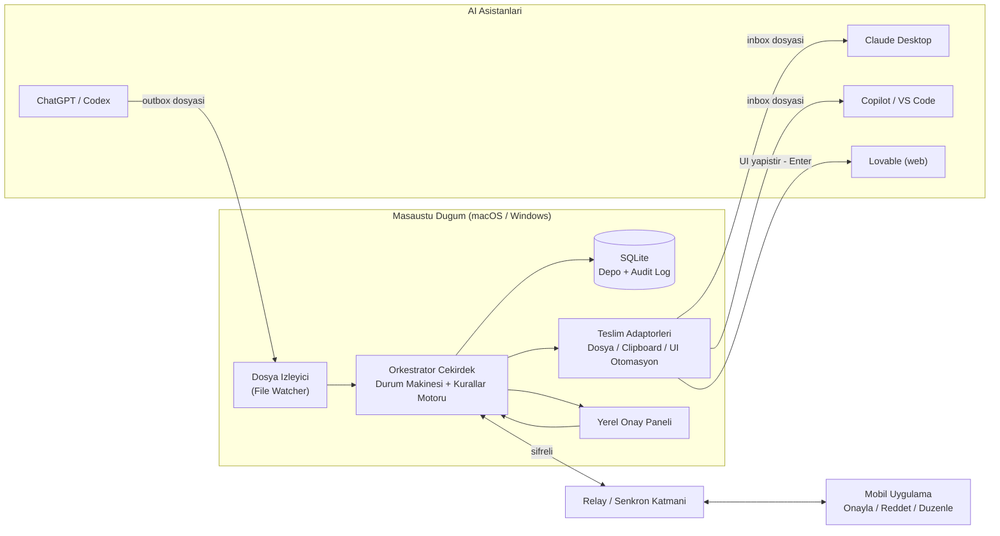
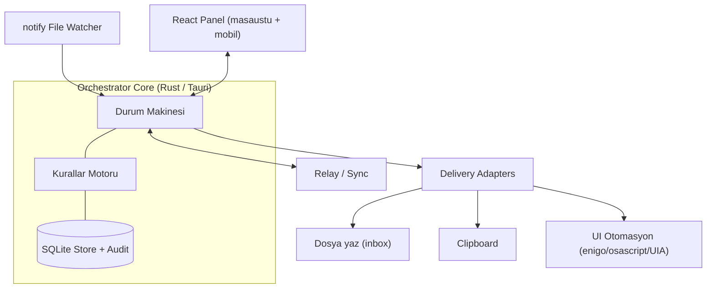
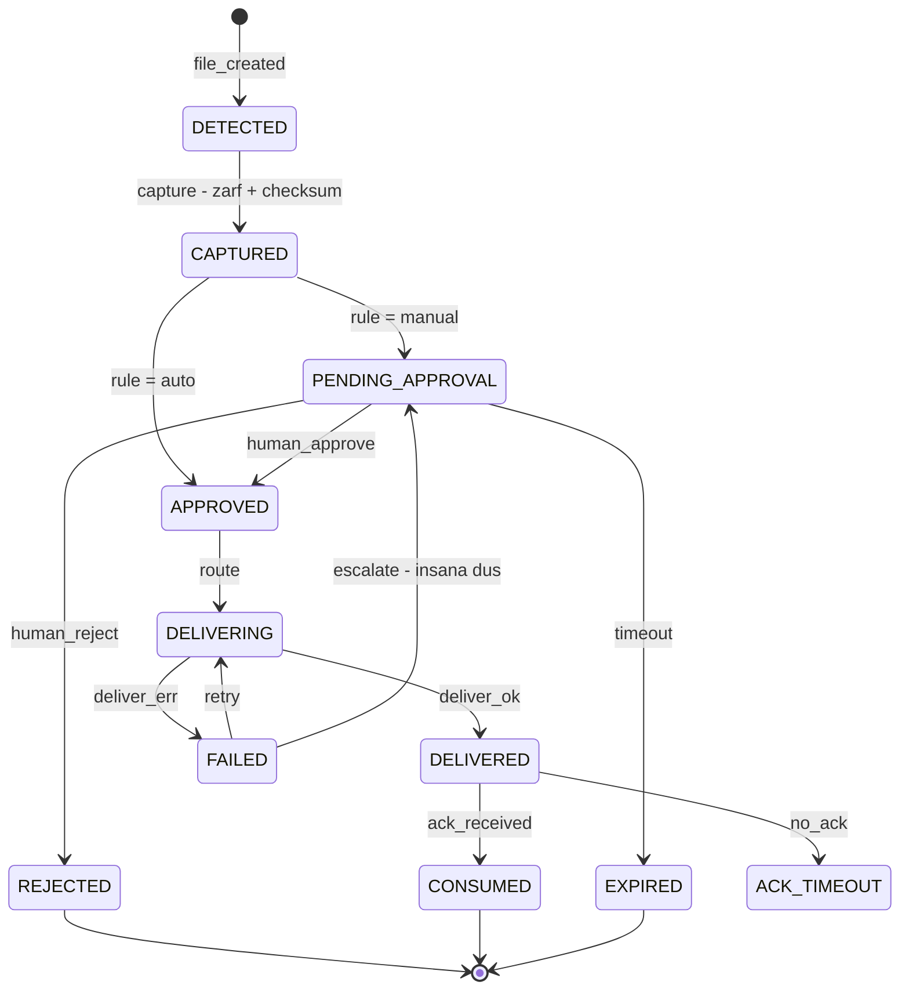
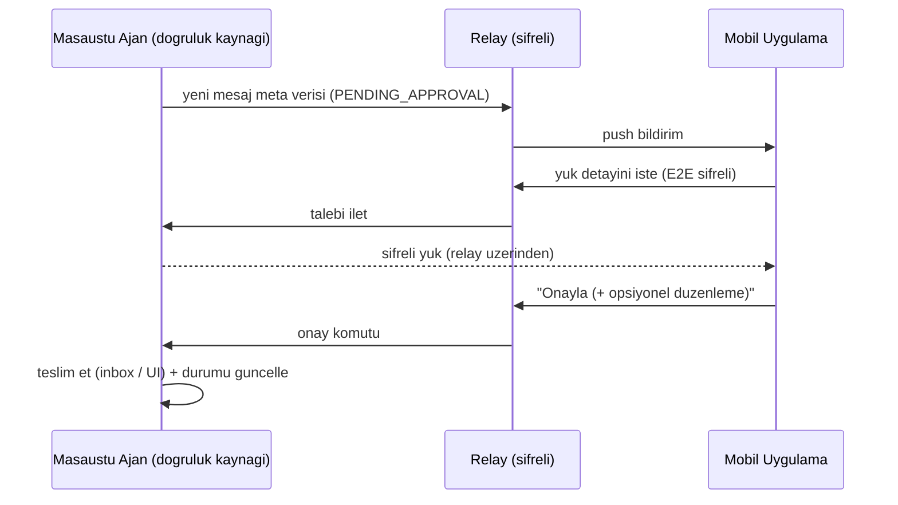
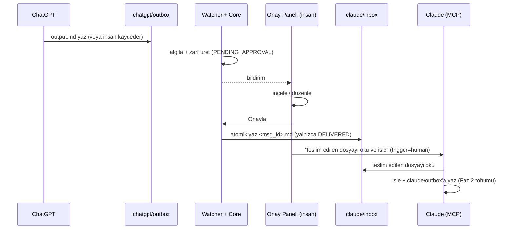

# AI Asistan Orkestrasyon Sistemi — Mimari Döküman

**Sürüm:** 1.4
**Tarih:** 15 Eylül 2026
**Hazırlayan:** Kıdemli Yazılım Mimarı (Claude) & Ürün Sahibi
**Kod adı:** *Conductor* (öneri) — İnsan Onaylı Çoklu-Asistan Orkestrasyonu
**Statü:** Onay bekliyor — kod yazımından önce mimari referans
**Revizyon 1.1 (15 Eylül 2026):** İki inceleyicinin (Codex + Claude) ortak bulguları işlendi — **K-003** içerik dondurma (§5.3), **K-004** benzersiz inbox adı + niyet-günlüğü teslim (§7.5/§7.7/§7.8), **K-005** teslim ≠ işleme / Faz 1 DELIVERED'da durur (§5.4). Ayrıntı: `_isbirligi/KARARLAR.md`.
**Revizyon 1.2 (24 Eylül 2026):** Faz 2 mimarisi **§11** olarak eklendi (runner durum makinesi, sağlayıcı politikası, süreç sahipliği, çökme/kurtarma, SSE, şema 1.2 + WAL, API güvenliği, bilinen sınırlar). §5.4 yalnız **envelope** makinesidir; runner makinesi ayrıdır (§11.2).
**Revizyon 1.3 (30 Eylül 2026):** Faz 3 mimarisi **§12** olarak eklendi (kalıcı çalışmalar ve devam kapısı, sonuca göre döngü, proje talimatı K-011, panelden takım, kota beklemesi K-012, sağlayıcı kapsamı K-013, şema 1.3–1.7, sürüm görünürlüğü). İşletim adımları `OPERATOR-REHBERI.md`'de.
**Revizyon 1.4 (7 Ekim 2026):** Faz 3 sonrası ve Faz 5 mimarisi **§13** olarak eklendi (sağlayıcı kimliği ve katalog, `agy`/Ollama adaptörleri, Codex yalıtımı, launchd, Mac kabuğu, önizleme yöneticisi, mobil geçit, şema 1.8 → 1.10, güven sınırları, bilinen sınırlar). Kaynak: F5-Kapanış kartı.

---

## 0. Yönetici Özeti

Amaç: Halihazırda kullanılan AI asistanlarını (ChatGPT/Codex, Claude, GitHub Copilot, Lovable) **API anahtarı olmadan**, bu asistanların **kendi yerel yeteneklerini** kullanarak birbirine bağlayan; bir asistanın çıktısını diğerine **insan onayıyla** aktaran bir orkestrasyon katmanı kurmak. Veri kazıma (scraping) yok; asistanlar arası köprü **dosya sistemi** üzerinden, gereğinde **UI otomasyonu** ile kurulur.

Bu dökümanın verdiği üç karar:

1. **İletişim Protokolü:** Birincil taşıyıcı **izlenen klasör (watched folder / dosya tabanlı IPC)**; ikincil taşıyıcı **clipboard**; son çare **native UI otomasyonu**. Bu sıralama, senin "önce dosya, UI son çare" tercihinle birebir örtüşüyor ve Eylül 2026'daki gerçek asistan yetenekleriyle de uyumlu.
2. **Tech Stack:** Tek kod tabanından macOS + Windows + iOS + Android üreten **Tauri 2 (Rust çekirdek + React/TypeScript arayüz)**. Dosya izleme `notify` (Rust), durum deposu SQLite, UI otomasyonu `enigo` + platforma özel katman. Mobil uzaktan yönetim için **masaüstü ajanı = doğruluk kaynağı**, ince bir **relay/senkronizasyon** katmanı üzerinden mobil sadece onay komutu gönderir.
3. **Faz 1:** Sadece **ChatGPT → Claude**, **manuel onaylı**, **dosya tabanlı** tek yönlü akış. Hızlı doğrulama için Tauri'den önce hafif bir **Python (watchdog) + yerel web paneli** prototipiyle başlanır, sonra Tauri'ye taşınır.

Kritik mimari içgörü: Bir dosyayı hedefin `inbox`'ına yazmak, hedef asistanın onu **okumaya başlamasını sağlamaz**. Bu "uyandırma/tetikleme problemi" (bkz. §4.5) tasarımın kalbindedir ve saf bir dosya-bırakma yaklaşımını gerçek bir sistemden ayıran şeydir.

---

## 1. Problem Tanımı ve Tasarım İlkeleri

### 1.1 Problem

Farklı AI asistanları farklı işlerde güçlü (ChatGPT/Codex ideasyon ve planlama, Claude uzun bağlam ve yazım/kod, Copilot repo içi kodlama, Lovable hızlı web uygulaması). Bugün bunların arasındaki bilgi transferi **elle kopyala-yapıştır** ile yapılıyor: yavaş, hatalı, izlenemez ve kontrolsüz. İstenen: bu transferi **organize eden, denetleyen ve insan onayına bağlayan** bir orkestratör — ama asistanların içine sızmadan, sadece onların **zaten sahip olduğu** dosya/masaüstü yeteneklerini kullanarak.

### 1.2 Tasarım İlkeleri (bu dökümanın anayasası)

| # | İlke | Anlamı |
|---|------|--------|
| P1 | **İnsan döngüde (Human-in-the-Loop)** | Her transfer, kural neyse ona göre ya manuel onaylanır ya da otomatik geçer; ama her zaman **denetlenebilir** ve **durdurulabilir**. |
| P2 | **Scraping yok** | Asistanın ekranını/oturumunu kazımayız. Yalnızca asistanın kendi ürettiği dosyayı veya kullanıcının bilinçli yapıştırdığı içeriği taşırız. |
| P3 | **Önce dosya, UI son çare** | Taşıyıcı tercih sırası: Dosya → Clipboard → UI otomasyonu. UI otomasyonu yalnızca dosya erişimi olmayan asistanlar için köprüdür. |
| P4 | **Asenkron ve dayanıklı** | Uygulama kapanıp açılsa da mesajlar kaybolmaz; her şey diskte/DB'de kalıcıdır. |
| P5 | **Adaptör tabanlı** | Her asistan bir "eklenti" (adapter) ile temsil edilir; yeni asistan eklemek çekirdeği değiştirmez. |
| P6 | **Gizlilik önce yerelde** | Çıktılar hassas olabilir; varsayılan olarak veriler **cihazda** kalır. Buluta yalnızca gerekli olduğunda ve şifreli çıkar. |
| P7 | **Denetlenebilirlik (Auditability)** | Her durum geçişi zaman damgalı loglanır: kim, ne zaman, neyi onayladı/reddetti/düzenledi. |

---

## 2. Kavramsal Model

Sistemi bir **mesaj komisyoncusu + iş akışı motoru (broker + workflow engine)** olarak düşün. Üç soyutlama var:

- **Agent Endpoint (Asistan Uç Noktası):** Bir AI asistanının sistemdeki temsili. Bir **yetenek profili** taşır: dosya okuyabilir mi? yazabilir mi? sadece clipboard mı? sadece UI mı?
- **Message / Envelope (Mesaj / Zarf):** Bir asistanın çıktısı + üzerine eklenen meta veri (kaynak, hedef, tür, durum, checksum, yönlendirme kuralı). Yük (payload) genelde bir `.md` dosyasıdır; zarf ise `.json`.
- **Route (Rota):** "chatgpt → claude" gibi bir kaynak-hedef eşlemesi + kuralı (manuel/otomatik, tür filtresi, dönüşüm).

Akış tek cümlede: **Kaynak asistan çıktı üretir → sistem yakalar → onay kuyruğuna girer → insan onaylar (manuel) veya kural tetikler (otomatik) → hedefin girdi kanalına iletilir → hedef işlemeye başlar.**



---

## 3. Asistan Yetenek Matrisi (Eylül 2026 Gerçekleri)

Protokol kararı tamamen bu tabloya dayanır. Her asistanın yerel dosya sistemine **gerçekte** ne kadar erişebildiğini güncel duruma göre doğruladım:

| Asistan | Yerel dosya oku/yaz | Mekanizma | Önerilen IPC katmanı | Kurulum yükü | Not |
|---|---|---|---|---|---|
| **Claude Desktop** | Yerel inbox okuması doğrulandı | Yerel **Add folder** bağlayıcısı (K-007) | **Dosya (native)** | Düşük | Bu kurulumda inbox okuması doğrulandı; Faz 2 outbox yazımı ayrıca doğrulanır. |
| **ChatGPT Desktop / Codex** | ✅ Mümkün | **MCP** (Codex host; `config.toml`) — hem yerel (stdio) hem uzak (HTTP) sunucu; Codex CLI doğrudan dosya erişimi | **Dosya (MCP/Codex)**, aksi halde UI | Orta | Şubat 2026'da MCP'ye tam destek geldi. Ana ChatGPT uygulaması geçmişte uzak konnektör odaklıydı; yerel dosya için Codex host / stdio MCP konfigürasyonu gerekir. |
| **GitHub Copilot (VS Code, agent mode)** | ✅ Birinci sınıf (workspace içi) | Agent mode + workspace dosya erişimi + MCP | **Dosya (workspace)** | Düşük | Zaten bir dosya-düzenleme ajanı. `agents/copilot/` klasörünü workspace açman yeterli. |
| **Lovable** | ❌ Yerelde yok | Web tabanlı; **GitHub senkronu** veya kod dışa aktarma | **UI otomasyonu** veya **git köprüsü** | Yüksek | Yerel klasör izleyemez. Ya git repo üzerinden dolaylı köprü, ya tarayıcıda UI otomasyonu. |

**Sonuç — asistanlar üç kademeye ayrılıyor:**

- **Kademe A (native yerel dosya):** Claude, Copilot → izlenen klasörü doğrudan okuyup yazabilir. **En sağlam.**
- **Kademe B (MCP kurulumuyla dosya):** ChatGPT/Codex → mümkün ama biraz kurulum ister; istenmezse UI'ye düşülür.
- **Kademe C (web-only, dosya yok):** Lovable → git köprüsü veya UI otomasyonu şart.

Bu kademelenme, "önce dosya, UI son çare" ilkesinin neden hem doğru hem uygulanabilir olduğunu gösteriyor: asistanların **çoğu** (A ve B) dosyayla çalışabiliyor; UI otomasyonu yalnızca gerçekten mecbur kalınan **Kademe C** için ayrılıyor.

---

## 4. İletişim Protokolü — Teknik Karar Analizi *(Çıktı 1)*

Soru: Asistanlar birbirinin çıktısını nasıl "görecek"? Üç aday taşıyıcıyı derinlemesine karşılaştırıyorum.

### 4.1 Aday 1 — İzlenen Klasör (Dosya Tabanlı IPC) — **BİRİNCİL**

Kaynak asistan çıktısını ortak bir klasördeki dosyaya yazar (ör. `agents/chatgpt/outbox/output.md`). Sistem bu klasörü izler, algılar, onaya düşürür; onaylanınca içeriği hedefin `inbox`'ına **atomik** olarak yazar.

**Artıları:**
- Sağlam ve **asenkron**: zamanlama kırılganlığı yok, uygulama yeniden başlasa da mesaj diskte durur.
- **Denetlenebilir ve sürümlenebilir**: her mesaj bir dosya; git/yedek/inceleme kolay.
- **Yapılandırılmış meta veri** taşır (zarf JSON'u): kaynak, hedef, tür, checksum.
- Kademe A/B asistanlarının **doğal** çalışma biçimi (MCP/workspace).
- Başsız (headless) çalışır; insan başında olmadan da kuyruk birikir.

**Eksileri:**
- Asistanın dosya okuyabilmesi için **kurulum** gerekir (MCP/Codex/workspace).
- **Uyandırma problemi**: dosyayı yazmak, asistanın okumaya başlamasını sağlamaz (bkz. §4.5).

**Sağlamlık detayları:** Yazımlar **atomik** olmalı — önce `.system/tmp/`'ye yaz, sonra hedefe `rename` et (yarı yazılmış dosyayı izleyicinin yakalamasını önler). İçerik bütünlüğü için SHA-256 checksum zarfta tutulur.

### 4.2 Aday 2 — Clipboard Manipülasyonu — **İKİNCİL / Yardımcı**

Onaylanan yük panoya (clipboard) yazılır; sonra hedef uygulamaya yapıştırılır.

**Artıları:** Evrensel; metin kutusu olan her uygulamayla çalışır; kurulum yok.
**Eksileri:** Tek bir **global pano** (yarış koşulları), kullanıcının panosunu **ezer**, yapı/meta veri taşımaz, boyut sınırı olabilir, ne yapıştırıldığının denetim kaydı yoktur.

**Karar:** Clipboard tek başına bir taşıma katmanı değil; **UI otomasyon adımının içinde yük taşıyıcısı** olarak kullanılır (kopyala → pencereye odaklan → yapıştır). Kullanıcının panosunu korumak için işlemden önce mevcut pano yedeklenip sonra geri yazılır.

### 4.3 Aday 3 — Native UI Otomasyonu — **SON ÇARE** (senin tercihin)

İşletim sisteminin otomasyon yetenekleriyle, onaylanan çıktı hedef uygulamanın metin kutusuna yapıştırılıp Enter'a basılır.

- **macOS:** AppleScript / JXA + **Accessibility API** (`System Events`), `osascript`. Erişilebilirlik ve (gerekirse) Ekran Kaydı izinleri istenir.
- **Windows:** **UI Automation (UIA)** framework, AutoHotkey veya PowerShell `SendKeys`.
- **Çapraz platform tuş/fare:** Rust `enigo` crate'i (Tauri çekirdeğinden çağrılır); karmaşık senaryolarda platforma özel betiklere (osascript/AHK) tırmanılır.

**Artıları:** Dosya erişimi olmayan asistanlarla (Lovable) çalışan **tek** yol; döngüyü tam kapatır (yapıştır + Enter → asistan başlar); "uyandırma" için de kullanılabilir.
**Eksileri:** **Kırılgan** (pencere odağı, koordinat, düzen değişikliği, zamanlama); OS **izin** istemleri; **riskli** (yanlış pencereye tuş gönderme); test etmesi zor; uygulama güncellemelerinde bozulur.

**Güvenlik kuralları (zorunlu):** İşlemden önce hedef pencereyi başlığa/uygulama kimliğine göre **doğrula**; odak beklenen pencerede değilse **iptal et**; yapıştırma sonrası bir doğrulama beklentisi koy; her UI eylemini logla; kritik "Enter" adımını (özellikle otomatik modda) opsiyonel olarak insan onayına bağla.

### 4.4 Karşılaştırma Tablosu

| Kriter | Dosya (Watched Folder) | Clipboard | UI Otomasyonu |
|---|:---:|:---:|:---:|
| Sağlamlık / dayanıklılık | ★★★★★ | ★★☆☆☆ | ★★☆☆☆ |
| Kurulum kolaylığı | ★★★☆☆ | ★★★★★ | ★★☆☆☆ |
| Meta veri / yapı | ★★★★★ | ★☆☆☆☆ | ★☆☆☆☆ |
| Denetlenebilirlik | ★★★★★ | ★☆☆☆☆ | ★★☆☆☆ |
| Evrensellik (her asistan) | ★★★☆☆ | ★★★★☆ | ★★★★★ |
| Döngüyü kapatma (asistanı başlatma) | ★☆☆☆☆ | ★★★☆☆ | ★★★★★ |
| Güvenlik riski (düşük = iyi) | ★★★★★ | ★★★☆☆ | ★★☆☆☆ |
| **Rol** | **Birincil** | **Yardımcı** | **Son çare / köprü** |

### 4.5 Kritik: "Uyandırma / Tetikleme" Problemi

Bir dosyayı `claude/inbox/`'a yazmak, Claude'un onu **okumaya başlamasını sağlamaz**. Bu, dosya tabanlı tasarımların gizli zorluğudur. Üç çözüm var:

1. **Ajan/polling döngüsü:** Hedef, bir ajan modunda `inbox`'ını periyodik/talimatla izler (Claude Code, Codex, Copilot **agent mode**). En temiz "hands-off" çözüm — hedef zaten bir dosya ajanı gibi çalışıyorsa.
2. **Minimal UI dürtme (nudge):** Sistem hedefin penceresine odaklanıp "inbox'ını oku" yazıp Enter'a basar. Bu, UI otomasyonunun **en hafif** ve en az riskli kullanımıdır (yük dosyada; UI sadece tetikler).
3. **İnsan tetikler:** Manuel modda insan zaten başında; onayladıktan sonra hedefe "inbox'ı işle" der. Faz 1 için en basiti.

**Tasarım kararı:** Sistem her rota için bir **tetikleme stratejisi** taşır (`none | agent-poll | ui-nudge | human`). Faz 1'de `human`; Kademe A asistanlar için `agent-poll`'a; tam otomasyon istenirse `ui-nudge`'a yükseltilir. Bu, "önce dosya, UI son çare" ilkesini tetikleme katmanında da korur.

### 4.6 Öneri — Taşıyıcı Seçim Matrisi

| Rota (kaynak → hedef) | Çıktı yakalama | Teslim (inject) | Tetikleme |
|---|---|---|---|
| ChatGPT/Codex → Claude | outbox dosyası (MCP/Codex) | Claude inbox dosyası (MCP) | human (Faz 1) → agent-poll |
| Claude → Copilot | Claude outbox (MCP) | Copilot workspace inbox | agent-poll (Copilot agent) |
| Herhangi → Lovable | kaynak outbox dosyası | **UI otomasyonu** (tarayıcı) veya git köprüsü | ui-nudge |
| Lovable → Herhangi | git export / **clipboard yakala** | hedef inbox dosyası | rotaya göre |

**Net karar:** Birincil kanal **dosya**. Clipboard, UI adımının içinde yük taşıyıcı. UI otomasyonu yalnızca (a) Kademe C asistanları ve (b) opsiyonel tetikleme için. Bu, tercihinle ve 2026 yetenek gerçekleriyle tam uyumlu.

---

## 5. Sistem Mimarisi ve Tech Stack *(Çıktı 2)*

### 5.1 Bileşen Mimarisi

| Bileşen | Sorumluluk |
|---|---|
| **Orchestrator Core (daemon)** | Durum makinesi, kurallar motoru, mesaj deposu. Arka planda çalışan servis. |
| **File Watcher** | Her asistanın `outbox`'ını izler; yeni/değişen dosyayı olaya çevirir. |
| **Message Store (SQLite)** | Zarflar, durumlar, denetim logu, kurallar. Tek doğruluk kaynağı. |
| **Rules Engine** | Rota başına manuel/otomatik kararı, tür filtreleri, dönüşümler. |
| **Delivery Adapters** | Asistan başına teslim: dosya yazma / clipboard / UI otomasyon. |
| **Approval Dashboard** | Masaüstü penceresi (Tauri webview) + mobil. Kuyruk, onay, düzenleme, kural yönetimi. |
| **Sync / Relay** | Masaüstü ↔ mobil köprüsü; şifreli; push bildirim. |

### 5.2 Önerilen Teknoloji Yığını

**Birincil öneri — Tauri 2 (tek kod tabanı → masaüstü + mobil):**

Tauri 2.0 stabil sürümü macOS, Windows, Linux **ve** iOS + Android'i **tek kod tabanından** üretebiliyor. Bu, "hem macOS hem Windows hem uzaktan yönetilebilir mobil uygulama" gereksininin **tek çerçeveyle** karşılanması demek — mimari olarak en temiz yol.

| Katman | Seçim | Neden |
|---|---|---|
| Uygulama çerçevesi | **Tauri 2** (Rust) | Çapraz platform (masaüstü **+ mobil**), küçük ikili, güvenli, düşük RAM |
| Arayüz | **React + TypeScript + Vite**, Tailwind + shadcn/ui | Panel için hızlı, bileşen zengini; masaüstü ve mobilde paylaşılır |
| Çekirdek dil | **Rust** | Dosya izleme, durum makinesi, performans, güvenli eşzamanlılık |
| Dosya izleme | Rust **`notify`** crate | Çapraz platform, olay tabanlı |
| Depo | **SQLite** (`sqlx`/`rusqlite`) | Gömülü, işlemsel, denetim logu için ideal |
| UI otomasyon | **`enigo`** + platforma özel (`osascript` / UIA·AHK) | Çapraz platform tuş/fare, gerektiğinde tırmanma |
| Bildirim | ntfy / APNs / FCM | Mobil push |

**Alternatif — Electron + React Native:** Masaüstü **Electron + Node.js** (`chokidar` izleyici, `better-sqlite3`) + mobil **React Native** (veya Flutter) + ortak backend. Ekosistem daha olgun ama **daha ağır** ve mobil için **ayrı kod tabanı** gerekir. Ekip Node'da çok güçlüyse düşünülebilir; aksi halde Tauri kazanır.

**Prototip için — Python:** Faz 1 doğrulaması için `watchdog` (izleyici) + `FastAPI` (yerel panel) ile **saatler içinde** çalışan bir iskele kurulabilir. Ürünleşmede Tauri'ye taşınır. **Öneri:** Faz 1'i Python prototipiyle doğrula, sonra Tauri'ye geç.



### 5.3 Mesaj Zarfı (Envelope) — JSON Şeması

Her çıktı, yanına bir zarf `.json` alır (ya kaynak asistan üretir ya da izleyici çıplak `.md`'den türetir):

```json
{
  "id": "msg_2026-09-15T14-03-22_a1b2",
  "schema_version": "1.0",
  "created_at": "2026-09-15T14:03:22+03:00",
  "source": { "agent": "chatgpt", "channel": "outbox_file", "artifact": "output.md" },
  "target": [ { "agent": "claude", "channel": "inbox_file" } ],
  "type": "spec",
  "title": "Kullanici auth akisi taslagi",
  "payload": {
    "format": "markdown",
    "origin_ref": "agents/chatgpt/outbox/output.md",
    "stored": "db",
    "captured_sha256": "9f2c…",
    "bytes": 4213,
    "versions": [ { "kind": "captured", "sha256": "9f2c…" } ]
  },
  "routing": { "mode": "manual", "rule_id": "gpt-to-claude", "trigger": "human" },
  "state": "PENDING_APPROVAL",
  "history": [
    { "state": "DETECTED", "at": "2026-09-15T14:03:22+03:00" },
    { "state": "CAPTURED", "at": "2026-09-15T14:03:22+03:00" }
  ],
  "human": { "approved_by": null, "edited": false, "note": null }
}
```

**Not (K-003 — içerik dondurma):** `payload` artık değişebilir bir dosya yoluna değil, **yakalamada dondurulan içeriğe** dayanır: içerik SQLite'ta saklanır (`stored: db`), `origin_ref` yalnızca kökeni gösterir. Panel, onay ve teslim hep aynı sürümü okur. Düzenleme `versions`'a `{ kind: "edited", sha256 }` ekler; **orijinal korunur** ve audit'e diff yazılır. Böylece içerik + hash + durum + audit tek DB transaction'ında değişir; kaynak dosya sonradan değişse bile onaylanan sürüm bozulmaz.

### 5.4 Durum Makinesi (State Machine)

> **Kapsam notu (1.2):** Bu bölüm **dosya köprüsünün (envelope)** durum makinesidir. Faz 2 runner'ının (session/step/attempt) ayrı ve bağımsız durum makinesi **§11.2**'dedir; iki makine birbirine karışmaz.

Sistemin kalbi. "Dosya Değişti → Onay Bekliyor → Onaylandı → İletildi → Hedef Başladı" adımlarını açık durumlar ve olaylarla modelliyoruz:



| Durum | Anlamı |
|---|---|
| `DETECTED` | outbox'ta yeni dosya görüldü |
| `CAPTURED` | zarf oluşturuldu, yük hash'lendi/depolandı |
| `PENDING_APPROVAL` | kuyrukta, insan onayı bekliyor (yalnızca manuel rotada) |
| `APPROVED` | insan onayladı **veya** otomatik kural tetikledi |
| `REJECTED` | insan reddetti (terminal) |
| `DELIVERING` | hedef inbox'a yazılıyor / UI ile enjekte ediliyor |
| `DELIVERED` | hedef inbox güncellendi / yapıştır+enter yapıldı |
| `CONSUMED` | hedef işlemeye başladığını bildirdi (ack) |
| `FAILED` | teslim hatası → yeniden dene veya insana yükselt |
| `ACK_TIMEOUT` / `EXPIRED` | hedef okumadı / onay çok bekledi |

**Ack (onay geri bildirimi) nasıl?** Hedef asistan işe başladığında kendi `outbox`'ına küçük bir `ack` dosyası (veya ilk çıktısı) yazar; sistem bunu `CONSUMED`'a geçiş sinyali sayar. Ack yoksa `ACK_TIMEOUT` ile panele "belirsiz" olarak düşer.

**Faz 1 notu (K-005):** Faz 1'de ack mekanizması **yoktur**; dolayısıyla mesajlar `DELIVERED`'da durur ve panel **"İletildi"** gösterir — asla "İşlendi / işleme başladı" demez. `CONSUMED`, msg_id taşıyan **açık alındı** gerektirir ve **Faz 2**'ye ertelenmiştir (agent-poll ack dosyası; geç-ack davranışı da orada tanımlanır). Dosyanın yazılması, hedefin okuduğunun kanıtı sayılmaz.

### 5.5 Kurallar Motoru — Manuel / Otomatik Akış

Rota başına kural, insan-döngüde ilkesini pratiğe döker. Örnek `rules.yaml`:

```yaml
routes:
  - id: gpt-to-claude
    from: chatgpt
    to: [claude]
    mode: manual          # manuel: her mesaj onaya düşer
    types: [spec, prose, task]
    trigger: human

  - id: claude-to-copilot
    from: claude
    to: [copilot]
    mode: auto            # otomatik: onaysız iletilir
    types: [code]
    trigger: agent-poll
    guard:                # otomatik modda güvenlik bekçileri
      max_bytes: 100000
      require_types: [code]
      quiet_hours: "23:00-07:00"   # bu saatlerde otomatik yerine manuel'e düş
```

**Güvenlik bekçileri (guards):** Otomatik mod bile koşulsuz değil — boyut sınırı, tür zorunluluğu, sessiz saatler gibi bekçiler otomatik akışı sınırlar; ihlalde mesaj otomatikten **manuel**'e düşürülür. Bu, "tam otomasyon" istendiğinde bile kontrolün elde kalmasını sağlar.

### 5.6 Mobil Uzaktan Yönetim ve Senkronizasyon Katmanı

Gereksinim: uygulamayı **uzaktan** (telefondan) yönetip onay verebilmek. Tasarım kararı: **masaüstü ajanı = doğruluk kaynağı ve icra makamı**; mobil = **ince uzaktan kumanda**. Mobil "mesaj X'i (şu düzenlemeyle) onayla" komutu gönderir; teslimi masaüstü yapar.

Üç senkron seçeneği:

| Seçenek | Açıklama | Artı | Eksi |
|---|---|---|---|
| **A. Self-hosted relay** *(gizlilik için önerilen)* | Rust/Go WebSocket sunucusu, Tailscale/Cloudflare Tunnel arkasında; şifreli zarf + onay komutu taşır | Üçüncü tarafa veri gitmez; tam kontrol | Kurulum/bakım sende |
| **B. BaaS (Supabase)** | Postgres + Realtime + Auth + Edge Functions; RLS ile yetki | Hızlı geliştirme, gerçek zamanlı abonelik, hazır push | Veri (şifreli de olsa) 3. tarafta durur |
| **C. P2P (WebRTC / Tailscale)** | Doğrudan cihazdan cihaza | Aracı yok | NAT/erişilebilirlik/uygulama uykusu karmaşası |

**Gizlilik deseni (önerilen):** Relay yalnızca **meta veri + onay kararlarını** taşısın; **tam yük varsayılan olarak masaüstünde kalsın**, mobil talep edince şifreli çekilsin (uçtan uca şifreli). Böylece hassas çıktılar buluta yığılmaz. Push bildirimi bir mesaj `PENDING_APPROVAL`'a girince gider.



### 5.7 Klasör / Workspace Yapısı

Faz 1 prototipinde `ai-orchestrator/`, uygulama ve veri alt dizinlerini birlikte içeren çalışma köküdür. Python komutları bu dizinde çalıştırılır. G1'de doğrulanan yerleşim:

```text
ai-orchestrator/
├── app/                         # uygulama kodu
│   ├── __init__.py
│   └── __main__.py
├── agents/
│   ├── chatgpt/
│   │   ├── outbox/              # Faz 1 giriş kanalı; G4 burada izleyecek
│   │   └── inbox/
│   └── claude/
│       ├── outbox/
│       └── inbox/               # onaylı teslimlerin hedefi
├── queue/
├── archive/
│   ├── delivered/
│   └── rejected/
├── .system/
│   └── tmp/                     # teslim için geçici veri alanı
├── .venv/                       # yerel ortam; .gitignore kapsamında
├── .gitignore
├── requirements.txt
└── README.md
```

**İzleme sınırı:** G4 yalnız `agents/chatgpt/outbox/` giriş dizinini izler; `ai-orchestrator/` kökünü tüm alt dizinleriyle izlemez. `app/`, `.venv/`, `queue/`, `archive/`, `.system/` ve hedef inbox giriş kaynağı değildir. `.gitkeep` dosyaları mesaj sayılmaz. Henüz G1'de çalışan bir izleyici yoktur.

**Sonraki görev/faz ekleri:** `.system/state.db` G2'de oluşturulur; `rules.yaml` yönlendirme kuralları uygulanırken eklenir. Copilot/Lovable uç noktaları Faz 3 kapsamındadır; G1 ağacına dahil değildir. `.system/` uygulama kodu değil, sistemin yönettiği veri alanıdır.

**22 Eylül 2026 inceleme düzeltmesi:** §5.7 mevcut G1 yerleşimiyle hizalandı (seçenek a); dosya taşıması veya ürün davranışı değişikliği yapılmadı.

---

## 6. Güvenlik, Gizlilik ve İşletim Kaygıları

| Alan | Kaygı | Azaltım |
|---|---|---|
| **Yol güvenliği** | MCP/adaptör yanlış klasöre yazabilir | Tüm erişimi `ai-orchestrator/` köküne **sandbox**'la; sembolik link/`..` reddet |
| **UI otomasyon riski** | Tuşların yanlış pencereye gitmesi | Eylemden önce hedef pencere başlığı/uygulama kimliği **doğrulaması**; uyumsuzsa iptal |
| **macOS izinleri** | Accessibility / Screen Recording istemleri | İlk kurulumda açıkça iste ve belgele; kullanıcıya neden gerektiğini anlat |
| **Clipboard hijyeni** | Kullanıcının panosunu ezme | İşlemden önce yedekle, sonra geri yükle |
| **Gizlilik** | Hassas çıktının buluta gitmesi | Varsayılan **yerelde tut**; relay yalnızca meta veri; yük **E2E şifreli** |
| **Denetim** | "Kim neyi onayladı?" | Her geçiş zaman damgalı, değişmez **audit log**; düzenlemeler diff'li saklanır |
| **Otomatik mod güvenliği** | Kontrolsüz zincir tetiklenmesi | **Guard**'lar + döngü/derinlik limiti + sessiz saatler + acil "hepsini duraklat" |
| **Zehirli içerik** | Bir asistanın çıktısında talimat enjeksiyonu | İçerik **veri** olarak taşınır; manuel modda insan görür; otomatik modda tür/boyut bekçileri |

---

## 7. Faz 1 — Adım Adım Kurulum Planı *(Çıktı 3)*

**Hedef:** Yalnızca **ChatGPT → Claude**, **manuel onaylı**, **dosya tabanlı** tek yönlü akış. Mobil, otomasyon, çok-atlama yok. Amaç orkestratör çekirdeğini ve onay akışını en küçük yüzeyle doğrulamak.

### 7.1 Kapsam ve Kabul Kriterleri

**Kapsam içi:** outbox izleme, zarf üretimi, yerel onay paneli, manuel onay/düzenleme/red, Claude inbox'a atomik teslim, audit log.
**Kapsam dışı:** mobil, otomatik mod, UI otomasyonu, Copilot/Lovable, çift yön.

**Bittiğinin kanıtı (Definition of Done):**
1. ChatGPT çıktısı `chatgpt/outbox/`'a düştüğünde panelde 3 sn içinde belirir.
2. İnsan içeriği **düzenleyip** onaylayabilir/reddedebilir.
3. Onay sonrası içerik `claude/inbox/`'ta bütün (checksum eşleşir) ve **atomik** olarak belirir.
4. Claude, inbox'taki dosyayı okuyup işleyebilir.
5. Her adım audit log'da zaman damgalı görünür; uygulama kapanıp açılınca kuyruk korunur.

### 7.2 Ön Koşullar

**Claude tarafı — K-007 ile güncel kurulum:** Claude Desktop'ın yerel **Add folder**
bağlayıcısıyla `agents/claude/inbox/` bağlanır. Bu kurulumda gerçek inbox okuması
Ürün sahibi tarafından doğrulandı. Eski `mcpServers` / npx filesystem yöntemi bu
uygulama sürümünde başarısız olmuş ve kullanımdan kaldırılmıştır.

Faz 2 ters yönü için `agents/claude/outbox/` ayrıca bağlanmalı ve Claude'un bu
klasöre dosya yazabildiği gerçek oturumda doğrulanmalıdır. Inbox okuma kanıtı
outbox yazma yetkisi kanıtı değildir. Yalnız ihtiyaç duyulan klasörler bağlanır.

**ChatGPT tarafı — iki seçenek:**
- **(a) Tam dosya yolu (Kademe B):** Codex host / stdio Filesystem MCP'yi aynı köke yönlendir; ChatGPT/Codex çıktıyı doğrudan `chatgpt/outbox/`'a yazar.
- **(b) İnsan-taşıyıcı (Faz 1 için en basit):** ChatGPT Canvas/çıktısını kullanıcı bilinçli olarak `chatgpt/outbox/output.md`'ye kaydeder. Bu hâlâ "dosya tabanlı"dır ve P2 (scraping yok) ile uyumludur — ilk taşıyıcı insandır. **Öneri:** Faz 1'e (b) ile başla (ChatGPT MCP kurulum sürtünmesini ele alma), çekirdek çalışınca (a)'ya yükselt.

### 7.3 Klasör Kurulumu

`ai-orchestrator/` kökünü ve §5.7'deki alt klasörleri oluştur. `.system/tmp/` atomik yazma için şart.

### 7.4 Dosya Adlandırma + Zarf

- Çıktı dosyası: `agents/chatgpt/outbox/output.md` (veya `YYYYMMDD-HHMMSS_baslik.md`).
- İzleyici, çıplak `.md` görürse §5.3'teki zarfı **otomatik türetir** (kaynak=chatgpt, hedef=claude, checksum hesapla).

### 7.5 Yakalama ve Teslim — Uygulama Sözleşmesi

**21 Eylül 2026 tutarlılık düzeltmesi:** Bu bölüm K-003/K-004 ve güncel G2 DAO sözleşmesini izler. Aşağıdaki akış sözde algoritmadır; çalışan veya test edilmiş uygulama değildir.

**Yakalama (G4):**

1. Hazır bir çıktı için benzersiz mesaj kimliği üret. Saniye tabanlı zaman damgasını tek başına kimlik olarak kullanma. Tekilleştirme ayrı bir sözleşmedir.
2. İçeriği ham bayt olarak oku; `insert_captured` ile BLOB, bu baytların hash'i, zarf ve audit kaydını tek DB transaction'ında sakla. `decode(..., "replace")` ile saklanan içeriği değiştirme.
3. G3 üzerinden `CAPTURED → PENDING_APPROVAL` geçişini yap ve paneli bilgilendir. Önizleme seçilen sürümü, teslim yalnız onaylanan sürümü kullanır.
4. Created/modified/moved olayları, başlangıç taraması ve dosyanın hazır sayılma koşulu G4 kartında tanımlanacak. Sabit süre beklemek tek başına tamamlanma garantisi değildir.

**Teslim (G5):**

1. Zarfın `approved_version_id` değerini ve bu sürümün değişmez baytlarını/hash'ini G2 deposundan al. Sürümün mesaj aidiyetini doğrula.
2. Güvenli, benzersiz hedef yolu üret: `claude/inbox/<msg_id>__<slug>.md`. `record_delivery_intent` hedefi ve onaylı sürüm kimliğini `DELIVERING` ile birlikte commit eder. Beklenen hash, işaret edilen değişmez `versions.sha256` alanından alınır; `delivered_sha256` henüz NULL olabilir.
3. Hedefle aynı dosya sisteminde, **her teslim denemesine özel yeni** geçici dosya oluştur (`mkstemp` gibi exclusive-create). İçeriği yaz, flush/fsync yap ve yazıcıyı kapat. Önceden kullanılan geçici yolu `wb` ile açma: çökme sonrası bu yol teslim edilmiş dosyayla aynı inode'a bağlı olabilir.
4. Tamamlanmış dosyayı `os.link(tmp, dest)` ile atomik ve üzerine yazmadan yayımla. Hedefi `O_EXCL` ile açıp ardından yazmak eşdeğer değildir; yarım içerik görünür. `exists` kontrolü ardından `os.replace` kullanma.
5. Hedef varsa üzerine yazma. Kalıcı teslim niyetindeki aynı yol için hedefin hash'i beklenenle eşleşiyorsa uzlaştır; farklıysa dosyayı koru ve teslim çatışması bildir. Normal akışta ve yeniden başlatmada aynı politika geçerlidir.
6. Hedefin gerçek baytlarından hash hesapla; `record_delivered(actual_sha256)` beklenen hash'i doğruladıktan sonra durum+audit'i commit eder. Desteklenen dosya sistemi/işletim sistemi için dizin kalıcılığı da G5'te ele alınır; dosya fsync'i tek başına elektrik kesintisinde dizin girdisinin kalıcılığını kanıtlamaz.
7. Geçici dosyayı temizle. Temizleme hatası veya süreç kesintisi, yayımlanmış hedefin yeniden yazılmasına yol açmamalı. Artık geçici dosyalar sonraki bakımda temizlenebilir.

**Zorunlu açılış uzlaştırması:** DB commit ve dosya yayımı ayrı işlemlerdir. `DELIVERING` kayıtlarında hedef yoksa aynı onaylı snapshot'tan yeni geçici dosyayla yeniden dene; hedef ve hash eşleşiyorsa tamamla; farklıysa çatışma bildir. Onaylanmamış güncel outbox içeriğini yeniden okuma.

**Faz 1:** Başarılı dosya teslimi yalnız `DELIVERED` üretir; ACK/`CONSUMED` Faz 2 kapsamındadır. Bu sözleşmenin uygulama ve kesinti testleri G5/G9'da yapılır.

### 7.6 Onay Paneli (Yerel)

Faz 1 için `localhost`'ta küçük bir web paneli (FastAPI + basit React/HTML). Ekranlar:
- **Kuyruk:** bekleyen mesajlar (kaynak, tür, başlık, zaman).
- **Detay:** markdown önizleme + **düzenlenebilir** metin alanı.
- **Aksiyonlar:** Onayla / Reddet / (düzenleyip) Onayla. Durum rozeti: Bekliyor · Onaylandı · Reddedildi · İletildi.

### 7.7 Teslim + Claude'u Tetikleme

Onay → teslim rutini (§7.5) → `claude/inbox/<msg_id>__<baslik>.md` (**benzersiz ad**, K-004; sabit `input.md` yok). Sonra tetikleme (Faz 1 = `human`): kullanıcı Claude'a "inbox'ındaki **teslim edilen dosyayı** (paneldeki teslim kaydında gösterilen tam dosya adıyla) oku ve işle" der. (Faz 2'de Claude Code/agent-poll ile otomatikleşir.) Dosyanın yazılması **yalnızca `DELIVERED`**'dır; Claude işlediğini kanıtlamadıkça **`CONSUMED` sayılmaz** (K-005).

### 7.8 Faz 1 Akış Diyagramı



### 7.9 Test / Kabul Checklist

- [ ] Boş/yarım dosya yazımı yanlış tetikleme yapmıyor (debounce + atomik).
- [ ] Checksum kaynak = hedef.
- [ ] Reddedilen mesaj `archive/rejected/`'a gidiyor, inbox'a **yazılmıyor**.
- [ ] Düzenlenmiş onayda **düzenlenmiş** içerik teslim ediliyor; diff audit'te.
- [ ] Uygulama yeniden başlatıldığında `PENDING_APPROVAL` kuyruğu duruyor.
- [ ] Claude inbox'ı MCP ile okuyabiliyor (izin/yol doğru).

---

## 8. Yol Haritası (Sonraki Fazlar)

**2026-09-25 / K-010:** Faz 3 sırası ürün sahibinin onayıyla güncellendi. İlk dilim F3-01a arka uç, F3-01b paneldir; ayrıntılar `_isbirligi/Faz-3-Plani.md` (yerel kayıt). Copilot/Lovable önceki öncelikti; şimdi yetenek doğrulaması gereken adaylardır. §11 gerçekleşen Faz 2 sistemini anlatır; Faz 3 planı çalışan özellik iddiası değildir.

| Faz | Kapsam | Ana kazanım |
|---|---|---|
| **Faz 1** | ChatGPT → Claude, manuel, dosya | Çekirdek + onay akışı doğrulanır |
| **Faz 2** | Çift yön + otomatik kurallar + guard'lar + agent-poll tetikleme | Gerçek "orkestrasyon"; Claude↔ChatGPT gidip gelir |
| **Faz 3 — onaylı plan, henüz uygulanmadı** | Kalıcı çalışma/takip mesajı → sınırlı takım döngüsü → takım seçimi → kapasite bekleme → yeni sağlayıcı yetenek kapısı | Aynı panelde devam eden, sınırları belirli takım çalışması |
| **Faz 4** | Tauri'ye taşıma + **mobil uygulama** + relay/sync | Uzaktan onay, push bildirim |
| **Faz 5** | Dönüşümler, şablonlar, çok-atlamalı iş akışları (DAG) | "ChatGPT tasarlar → Claude yazar → Copilot uygular" zincirleri |

---

## 9. Riskler ve Azaltımlar

| Risk | Etki | Azaltım |
|---|---|---|
| Asistan yetenekleri hızla değişiyor (2026) | Adaptör bozulabilir | Adaptör deseni; çekirdek asistandan bağımsız; yetenek profili konfigüre edilebilir |
| UI otomasyonu kırılgan | Teslim başarısız | Önce dosya; UI son çare; pencere doğrulama; başarısızlıkta insana yükselt |
| Uyandırma problemi | Hedef okumaz | Açık tetikleme stratejisi (human/agent-poll/ui-nudge) |
| Otomatik zincir kaçağı | İstenmeyen tetiklenmeler | Guard'lar, derinlik limiti, sessiz saatler, acil duraklatma |
| Gizlilik (mobil/relay) | Veri sızıntısı | Yerelde tut; E2E şifreleme; relay yalnızca meta veri |
| Aşırı mühendislik | Gecikme | Faz 1'i Python prototipiyle küçük tut; sonra Tauri |

---

## 10. Sözlük

- **Watched Folder / Dosya Tabanlı IPC:** Asistanların ortak, izlenen bir klasör üzerinden dosyayla haberleşmesi.
- **Envelope (Zarf):** Yükün yanındaki meta veri (kaynak, hedef, tür, durum, checksum).
- **Adapter (Adaptör):** Bir asistanı sisteme bağlayan, çıktı yakalama + girdi enjekte etme modülü.
- **State Machine (Durum Makinesi):** Mesajın izlediği durumlar ve geçişler.
- **Trigger (Tetikleme):** Hedefin inbox'ını okumaya başlamasını sağlayan mekanizma (human / agent-poll / ui-nudge).
- **Guard (Bekçi):** Otomatik akışı sınırlayan koşul (boyut, tür, saat).
- **Relay / Sync:** Masaüstü ajanı ile mobil uygulama arasındaki şifreli köprü.
- **MCP (Model Context Protocol):** Asistanların yerel araçlara/dosyalara eriştiği açık standart.

---

## 11. Faz 2 Mimarisi — Runner, Kurtarma ve Dayanıklılık

> **Kaynak ilkesi:** Bu bölümdeki her davranış iddiası koddaki bir yere dayanır (dosya adları parantez içinde). Kod ile belge çelişirse **kod doğrudur**, belge düzeltilir.
> **Plan ile gerçekleşen:** §8'deki Faz 2 satırı ("çift yön + otomatik kurallar + agent-poll") ilk plandı. Gerçekleşen Faz 2: çift yönlü manuel aktarım (F2-01) + programatik runner (F2-02) + kota devri / bağlam devamı / kurtarma (F2-03a/b/c) + dayanıklılık (F2-04). Otomatik kurallar motoru (§5.5) ve agent-poll tetikleme Faz 2'de uygulanmadı.

### 11.1 Genel Bakış — iki bağımsız motor

Faz 2 sonunda sistemde **iki ayrı iş motoru** vardır. İkisi **iç içe değil, yan yanadır**: aynı SQLite dosyasını, API sürecini ve paneli paylaşırlar ama birbirlerinin tablolarına yazmazlar ve birbirlerinin durumlarını değiştirmezler.

| | **Dosya köprüsü (envelope)** — Faz 1 | **Runner (session)** — Faz 2 |
|---|---|---|
| Ne yapar | Bir asistanın çıktı dosyasını yakalar, insan onayıyla diğerinin inbox'ına atomik teslim eder | Tek bir görevi yazar → inceleyici → yazar adımlarıyla, sağlayıcı CLI'larını alt süreç olarak çalıştırarak yürütür |
| Tetik | `outbox/`'a düşen dosya (watcher) | Panelden / `POST /api/sessions/start` |
| Birim | envelope + immutable `versions` + append-only `history` | session → step → attempt (+ events, snapshots, owners) |
| Durum makinesi | §5.4 (G3): CAPTURED → PENDING_APPROVAL → APPROVED → DELIVERING → DELIVERED / REJECTED / FAILED | §11.2 |
| Kod | `store.py`, `transitions.py`, `delivery.py`, `watcher.py`, `api.py` | `runner.py`, `runner_store.py`, `session_api.py`, `adapters/*`, `provider_policy.py`, `context_digest.py`, `handoff.py` |

> Runner bir envelope'u "koşturmaz"; envelope da bir session'ın parçası değildir. Yeni runner durumları (WAITING_*, RECOVERY_REQUIRED, continuation) **envelope makinesine eklenmemiştir** ve eklenmemelidir.

Ortak altyapı: SQLite (WAL, §11.7), FastAPI süreci + tek runner sahibi (`session_api.worker_lifespan`, `.runner.lock` flock), SSE olay akışı, React paneli (iki sekme: **Çalışmalar** = runner, **Dosya onayları** = envelope).

---

### 11.2 Runner durum makinesi

Üç katman vardır; her birinin durumu ayrı tutulur.

**Session** (`sessions.status`)

| Durum | Anlam | Kim yazar |
|---|---|---|
| QUEUED | Kabul edildi, worker bekliyor | `create_session` / `retry` |
| RUNNING | Worker sahiplendi, kilit alındı (`claim_session`, CAS) | runner |
| SUCCEEDED | Üç adım da COMPLETED | runner |
| FAILED | Kurtarılamaz hata **veya** insan kurtarması sonrası terminal (`terminal_reason='recovered_by_human'`) | runner / `complete_recovery` |
| CANCELLED | Kullanıcı durdurdu | runner / cancel |
| WAITING_CAPACITY | Rolün tüm sağlayıcıları yapılandırılmış kota hatası verdi | runner |
| WAITING_AUTH / WAITING_APPROVAL | Sağlayıcı hesap girişi / araç izni istedi | runner (`AdapterResult.failure_state`) |
| WAITING_CONTEXT | Bağlam devamı kapalı / sınırı doldu / paket sığmıyor | runner (`_wait_context`) |
| RECOVERY_REQUIRED | Süreç temizliği doğrulanamadı **veya** sunucu iş ortasında çöktü; **kilit tutulur** | runner (`ProcessCleanupError`) / açılış (`worker_lifespan`) |

**Geçişler (session):**
```
QUEUED → RUNNING → SUCCEEDED
                 → FAILED | CANCELLED
                 → WAITING_CAPACITY | WAITING_AUTH | WAITING_APPROVAL | WAITING_CONTEXT
                 → RECOVERY_REQUIRED            (temizlik doğrulanamadı / çökme)
WAITING_CONTEXT | WAITING_CAPACITY | WAITING_AUTH  --retry (insan)-->  QUEUED
RECOVERY_REQUIRED  --recover + confirm (insan), ölüm kanıtlı-->  FAILED (recovered_by_human)
RECOVERY_REQUIRED  --recover, ölüm kanıtlanamadı-->  RECOVERY_REQUIRED (kilit korunur)
```
WAITING_APPROVAL için retry yoktur; araç izni akışı dosya onayları tarafında yürür.

**Step** (`session_steps.status`): PENDING → RUNNING → COMPLETED | FAILED | CANCELLED. Adımlar sabit sırada: yazar (WRITE) → inceleyici (READ_ONLY) → yazar (WRITE). COMPLETED adım yeniden çalıştırılmaz.

**Attempt** (`session_attempts.status`): RUNNING → COMPLETED | FAILED | QUOTA | CONTEXT_EXHAUSTED | CANCELLED. Her attempt bir sağlayıcı alt sürecidir; kök attempt'ler `continuation_no=0`, bağlam devamları `continuation_no>0` + `continuation_of=<parent>`.

---

### 11.3 Sağlayıcı politikası ve iki döngü

- **Dondurulmuş zincir** (`provider_policy.normalize`, `session_policies`): rol başına 1–2 sağlayıcı, profil role bağlı (author=WRITE, reviewer=READ_ONLY). Session başında kaydedilir, değiştirilemez (trigger); runner `providers.yaml`'ı yeniden okumaz. Kullanıcı zinciri başlatmadan önce görüp kabul eder; digest değiştiyse `start` 409 döner.
- **DIŞ döngü — kota devri** (F2-03a): yalnız yapılandırılmış `error_code == QUOTA_EXCEEDED` (protokol alanından, model metninden değil — `provider_errors.py`) zincirdeki sıradaki sağlayıcıya geçer. Geçişten önce `attempt_clean` şarttır. Devir paketi snapshot farklarını ve gerçek `command_result` kanıtlarını taşır; `attribution: unknown`, `protection_guarantee: false`.
- **İÇ döngü — bağlam devamı** (F2-03b): yalnız Codex'te `contextWindowExceeded → CONTEXT_EXHAUSTED`. Aynı sağlayıcıda **taze oturum** (`thread/start`, resume değil) açılır, deterministik digest (≤64 KiB) ve prompt (≤128 KiB) ile devam edilir. Adım başına ortak sınır 0..3 (varsayılan 3); kota devri sayacı sıfırlamaz; adım deadline'ı yenilenmez.
- **Durulan kodlar:** AUTH / PERMISSION / UNKNOWN (ör. `sessionBudgetExceeded`) → terminal, otomatik yeni oturum ya da yedek sağlayıcı yok.

---

### 11.4 Süreç sahipliği ve çalışma klasörü kilidi

- Her sağlayıcı kendi süreç grubunun lideridir (`spawn_owned`, `start_new_session=True`). Kimlik `(pid, start_time, pgid, boot_time)` olarak model çalışmadan **önce** kaydedilir (`process_owners`). Bir gate FD, kayıt commit edilmeden `exec`'i engeller.
- Durdurma (`stop_process`): SIGTERM → gerekirse SIGKILL → **grup ölümü süre sınırlı doğrulanır**. Doğrulanamazsa `ProcessCleanupError` fırlar → session RECOVERY_REQUIRED, **kilit bırakılmaz**.
- `workspace_locks` (PK = kanonik yol): bir klasörde aynı anda tek Conductor işi çalışır. Kilit yalnız Conductor işlerini kapsar; dış editörleri ya da ajanları engellemez.

---

### 11.5 Çökme ve kurtarma — neden otomatik değil

**Durum:** Sunucu iş ortasında ölürse sağlayıcı süreçleri yetim kalabilir ve çalışma klasörüne yazmaya devam edebilir. Açılışta `worker_lifespan`, QUEUED/RUNNING durumundaki session'ları **RECOVERY_REQUIRED** yapar ve **kilitleri tutar**.

**Neden otomatik kurtarma yok:** Yetim süreçleri öldürmek geri alınamaz bir işlemdir ve yanlış süreci vurma riski taşır (PID yeniden kullanımı, reboot sonrası anlamsız PGID). Sistemin görevi, neyin öldürüleceğini **insana göstermek** ve **yalnız kanıtlanabilen ölümle** kilidi bırakmaktır.

**Güvenlik sırası** (`session_api.recover_session` → `process.reap_owned` → `runner_store.complete_recovery`):
1. **İnsan onayı önce gelir:** `GET /recovery` sahipli süreçleri gösterir, UI iki adımlı onay ister, API `confirm:true` olmadan **422** döner.
2. **Reap:** önce reboot kontrolü (`boot_time` değiştiyse sinyal yok, süreç zaten ölü), sonra lider kimlik kontrolü (PID yeniden kullanılmışsa sinyal yok). Lider canlıysa `killpg` SIGTERM → gerekirse SIGKILL. Lider ölüyse yalnız `process_group_snapshot` ile kaydedilmiş güvenilir üyeler tek tek öldürülür, her sinyalden hemen önce kimlik yeniden doğrulanır.
3. **Ölüm doğrulaması:** grup gerçekten boşalmalıdır.
4. **Yalnız her kanıt `ok` ise:** kurtarma kaydı, owner STOPPED, açık attempt ve RUNNING/FAILED adım kapatılır, **sonra** kilit bırakılır, **sonra** session FAILED / `recovered_by_human`.
5. **Atfedilemeyen canlı üye varsa** hiçbir şey öldürülmez, kilit korunur, engelleyen PID/PGID ile "OS düzeyinde manuel temizleme gerekebilir" uyarısı gösterilir.

Kanıt: `_isbirligi/teslimler/F2-05-kanit/claude-recovery-drill-after-fix.txt` (SIGKILL → RECOVERY_REQUIRED → 422 → confirm → grup ölü → kilit 0).

---

### 11.6 Olay akışı (SSE) ve panel

- `session_events` tablosu append-only kontrol noktalarıdır: attempt_started, output_delta, command_result, handoff, context_digest, context_continuation, recovery, step_completed…
- `GET /api/sessions/{id}/events` yalnız bu tabloyu akıtır; her olayda `id: seq` gönderilir. Normal yeniden bağlanmada `Last-Event-ID` ile kaldığı yerden devam eder; çalışma yeniden seçilince geçmiş baştan okunur.
- Panel **yalnız** bu veriden ve `/api/sessions*` yanıtlarından çizilir; sabit ya da uydurma durum gösterilmez. "Bağlam devamı hazırlandı" ile "Yeni oturumda devam" ayrımı ve "Kurtarıldı" ibaresi yalnız ilgili gerçek olaydan sonra görünür.

---

### 11.7 Veri katmanı

- **Şema 1.2** (`schema.sql`, `schema_meta`). 1.1 → 1.2 yükseltmesi sürümlü bir tablo yeniden oluşturmasıdır: FK kontrolü transaction dışında kapatılır, rebuild ve sürüm kaydı tek transaction içinde yapılır, commit öncesi `foreign_key_check` çalışır, tek sahip `fcntl` ile garanti edilir, işlem idempotenttir ve bilinmeyen sürüm reddedilir. İki 1.1 biçimi desteklenir: `session_attempts` **olan** (F2-03a sonrası) ve **olmayan** (F2-02 dönemi — F2-05 canlı provasında yakalandı).
- **Bağlantı** (`store.connect`): kalıcı DB'de `journal_mode=WAL`, `synchronous=NORMAL`, `busy_timeout=5000`; `:memory:` bağlantısında uygulanmaz. WAL, okuyucuların yazıcıyı beklemesini ölçülen senaryoda kaldırır; tek yazıcı kuralı sürer ve "hiç kilit hatası olmaz" garantisi verilmez.

---

### 11.8 API güvenliği ve hata biçimi

- Tüm mutasyon uçları (envelope approve/reject/edit/reconcile, session start/cancel/recover/retry) açık `Depends(mutation_guard)` kullanır. Yabancı Origin ya da `sec-fetch-site: cross-site` → **403**. GET ve statik dosyalar korunmaz. İzinli originler tek kaynaktan gelir (`security.ALLOWED_ORIGINS`), CORS da aynı sabiti kullanır. Origin göndermeyen yerel CLI istemcileri desteklenir.
- Hata gövdesi tek biçimdedir: `{"detail": "<insan-okur>", "code": "<makine>"}` (`errors.py`). Beklenmeyen 500'lerde exception metni, validation hatalarında girdi değerleri yanıta yazılmaz.
- API anahtarı kullanılmaz; sağlayıcılar kendi CLI'ları ve kullanıcının kendi oturumlarıyla çalışır.

---

### 11.9 Bilinen sınırlar (dürüstlük)

- **Bağlam devamı yalnız Codex'te:** Claude için doğrulanmış yapısal bağlam sinyali yok; Claude'un bağlam hatası FAILED olur.
- **Adım ortasından devam yok:** `retry`, FAILED adımı `task_prompt`'tan **baştan** çalıştırır. Diskteki değişiklikler kalır ama sağlayıcı konuşması taşınmaz.
- **Otomatik devam sınırlı, otomatik kurtarma yok:** Bağlam devamı en fazla 3 ek oturum açar. WAITING_* durumları insan retry'ı, RECOVERY_REQUIRED insan onayı bekler; kapasite dolmasını bekleyip kendiliğinden devam etme yoktur.
- **Kurtarmada atıf sınırı:** Lider ölü ve grup için snapshot yoksa (çökme tur ortasında olduysa) canlı üyeler atfedilemez. Sistem kilidi korur ve manuel temizlik ister.
- **Yalnız yerel:** API localhost'ta çalışır; CSRF koruması origin tabanlıdır, token yoktur.
- **Hata yolları fixture ile kanıtlandı:** Kota, bağlam ve çökme yolları gerçek hesap tüketilmeden fixture ve gerçek alt süreçlerle kanıtlandı. Gerçek hesapla yalnız mutlu yol koşuldu.
- **`sessionBudgetExceeded`** otomatik devam kapsamı dışında.
- **Tek yazıcı:** WAL okuyucuları bloklamaz, ama yazıcılar sırayla çalışır. Ölçülen 30 sn'lik sert karma yükte 0 kilit hatası görüldü; yazıcı beklemesi en fazla ~1,7 sn oldu. Bu `busy_timeout=5000` içinde kalıyor ama genel bir garanti değil.
- **Adaptör sözleşmesi (değişmez):** Her adaptör, çıkış yolu ne olursa olsun (başarı, hata, iptal) süreç grubunu `finally` içinde durdurup ölümünü doğrulamalıdır. Runner, hata yolunda owner'ı STOPPED olarak bu doğrulamaya güvenerek işaretler. Doğrulama yapmayan yeni bir adaptör bu kaydı yanıltıcı hale getirir.

---

## 12. Faz 3 Mimarisi — Kalıcı Çalışmalar, Döngü ve Kontrollü Bekleme

> **Kaynak ilkesi (§11 ile aynı):** her davranış iddiası koddaki bir yere dayanır; kod ile belge çelişirse kod doğrudur. Faz 3 kararları: K-010 (kapsam ve sıra), K-011, K-012, K-013. Günlük işletim: `OPERATOR-REHBERI.md`.
> **Plan ile gerçekleşen:** F3-01a/b, F3-02, F3-03, F3-04 uygulandı ve canlıda; F3-05 (yeni sağlayıcı) fizibilite başarısız olduğu için daraltıldı (K-013); F3-06 bu bölüm, operatör rehberi ve provalarla kapanış paketidir.

### 12.1 Çalışma (work) → mesaj → yürütme

Faz 2'nin tek seferlik session'ı, Faz 3'te bir **çalışmanın** (work) içindeki yürütmelerden biri oldu (`works_store.py`, `works_api.py`, `work_dispatcher.py`).

| Kavram | Tablo | Not |
|---|---|---|
| Çalışma | `works` | Tek klasör, başlık, arşiv; istemci kimliğiyle idempotent oluşturma |
| Mesaj | `work_messages` | Kullanıcının her isteği; `client_message_id` + payload özeti idempotent (aynı kimlik + farklı içerik → 409 `IDEMPOTENCY_CONFLICT`); içerik ve **dondurulmuş politika** (`policy_json`, `policy_digest`) trigger ile değiştirilemez |
| Yürütme | `work_runs` → `sessions` | Mesaj başına bir session; §11'deki runner aynen çalışır |
| Olaylar | `work_events` | Çalışma düzeyi akış (`GET /api/works/{id}/events`, SSE) |

- **Tek sahipli dağıtıcı** (`WorkDispatcher`): PENDING mesajları sırayla session'a çevirir; çifte dağıtımı bellekteki nesne değil `dispatch_next` içindeki DB CAS önler. Uyandırma: mesaj eklenmesi, biten iş, zamanlayıcı; ayrıca yavaş periyodik tarama.
- **Kuyruk kapısı** (`blocker`): son yürütme aktifse (`run_active`), bekliyorsa (`run_waiting`: WAITING_CAPACITY/AUTH/APPROVAL/CONTEXT/HUMAN), kurtarma istiyorsa, duraklatılmışsa ya da FAILED/CANCELLED bitip kullanıcı “sonucu inceledim, devam” (`POST /api/works/{id}/continue`) demediyse sıradaki mesaj başlamaz.
- **Devam kapısı** (`decide_resume`, `work_resume_refs`): takip mesajında yazar, önceki başarılı yürütmenin Codex konuşmasını **yalnız her koşul tutarsa** sürdürür — aynı çalışma/klasör/sağlayıcı/rol/profil/politika, önceki yürütme başarılı, son yazar attempt'i Codex ve temiz kapanmış, konuşma kimliği kayıtlı, klasör o yürütmenin bitiş snapshot'ından (`work_success_end`) beri değişmemiş, arada başka Conductor yazarı yok. Aksi hâlde **FRESH** + ilk tutmayan neden (panelde gösterilir). İnceleyici her yürütmede tazedir; sağlayıcılar arası konuşma kimliği taşınmaz. İnsan yeniden denemesi her zaman taze başlar.
- **İstem sınırları** (`work_prompt.py`): tür başına biçim (taze/devam yazar, inceleyici, düzeltme), zorunlu bölümler kesilmez, 128 KiB kapısı; aşılırsa model çağrılmaz (`PROMPT_TOO_LARGE`).

### 12.2 Sonuca göre döngü (F3-02, opt-in)

`providers.yaml`'da `loop:` varsa yeni mesajlar sabit üç adım yerine **tur döngüsüyle** yürür (politika sürüm 3; `loop_store.py`, `review_result.py`).
- Tur = yazar (WRITE) → inceleyici (READ_ONLY). İnceleyicinin son cevabı tek bir katı ```` ```conductor-review ```` JSON bloğu olmalıdır (≤32 KiB, yinelenen alan/NaN/fazladan metin reddi); karar `pass | changes_requested | blocked`, okunamazsa `invalid`.
- Bitiş sonuçları (`session_loop_state.outcome`): `verified`, `reviewer_blocked`, `review_invalid`, `no_progress` (aynı bulgu özeti + klasörde değişiklik yok), `turn_limit`, `budget_exhausted`. Yalnız `verified` kuyruğu kendiliğinden açar; diğerleri kullanıcının “devam” kararını ister.
- Bütçe: `max_turns` 1–5, `max_active_minutes` 5–120 — yalnız etkin yürütme süresi sayılır (kuyruk, bekleme, duraklama sayılmaz; `session_time_segments`, çökmede muhafazakâr üst sınır).
- Duraklat/devam yalnız adım sınırında (`pause_snapshot_id`). Devamda kullanıcı duraklatmadan beri klasörde olan değişikliği görüp onaylar (`resume_digest`); klasör değişmişse sonraki yazar taze konuşmayla başlar (`resume_fresh`); onaydan sonra klasör yeniden değişirse devam reddedilir ve yürütme yine duraklar (`resume_rejected`).

### 12.3 Proje talimatı ve izolasyon (TB-03, K-011)

Claude oturumları `--safe-mode` ile izole çalışır; kullanıcının ve projenin Claude ayarları/plugin/hook'ları yüklenmez. Çalışma klasörünün `CLAUDE.md`'si (+ kendi satırındaki göreli `@import`'lar, ≤5 seviye, 16 KiB) Conductor tarafından okunur, session başında içerik + manifest + `combined_digest` ile **dondurulur** (`session_project_instructions`, değiştirilemez) ve yalnız **yeni** bir Claude konuşmasına eklenir. Geçersiz talimat (mutlak yol, symlink, döngü, sınır aşımı…) session'ı model çağırmadan FAILED yapar.

**Codex (TB-05, K-014/K-015):** her Codex süreci Conductor'ın `.system/codex-home`'unu `CODEX_HOME` olarak kullanır (kişisel plugin/MCP/`notify`/model ayarı yok) ve `-c project_doc_max_bytes=0` ile başlar. Politika Codex çalıştırıyorsa kök `AGENTS.md` aynı kurallarla (import yok) `session_agents_instructions`'a dondurulur ve yalnız yeni Codex konuşmasına eklenir. Codex WRITE oturumunda proje kökünü kendiliğinden `trusted` yazdığı için Conductor her süreçten önce çalışma klasörünü ve git kökünü kendi alanında `untrusted` sabitler (hedef reponun `.codex/` MCP/hook katmanı kapalı kalır). TB-05 öncesi `~/.codex` konuşmaları devam ettirilmez (`codex_home_changed`).

### 12.4 Panelden takım (F3-03)

- `providers.yaml` **tavanı** belirler: `roles` varsayılan takım, `allowed` rol başına izinli sağlayıcılar (yoksa varsayılan takım), bütçeler (`max_context_continuations`, `loop`). Tarayıcı dosya yazmaz.
- Kullanıcı her mesaj için takımı seçer; `GET /api/sessions/providers/preview` dondurulacak politikayı ve digest'i gösterir, mesaj bu digest'le kabul edilir (bayat digest → 409, izin dışı takım → 422 `team_invalid` + sorun listesi). Takım mesaj payload özetine girer.
- Yetenek matrisi kodda (`provider_policy.CAPABILITIES`): profil desteği ve bağlam devamı (yalnız Codex).
- Oturum kontrolü (`provider_auth.py`) yalnız açık istekle (`?check_auth=true`) çalışır, model çağırmaz, sabit argv + kendi süreç grubu + süre sınırı; grup ölümü doğrulanamazsa o sağlayıcı için yeni kontrol yapılmaz (`probe_cleanup_failed`).

### 12.5 Kotada sınırlı bekleme (F3-04, K-012)

Mesajla seçilirse (`wait_on_quota`, süre 1–24 saat, deneme 1–5; mesajla dondurulur, idempotency özetine girer, zincir digest'ine girmez) zincir sonundaki doğrulanmış kota bir **bekleme planı** açar (`wait_plans.py`, `retry_plans`).
- Oturum başına tek canlı plan (kısmi UNIQUE indeks); son süre ilk kotaya sabit, deneme sayısı yeniden kotalarda birikir → bekleme her zaman biter (EXPIRED → session FAILED).
- Karşılaştırma tabanı her kota anında, kilit tutulurken `workspace_snapshots(kind='wait_start')` olarak alınır.
- `RetryScheduler` (tek sunucu, 60 sn tarama; tekillik DB CAS): vadesi gelen planı alır → klasör meşgulse deneme saymadan erteler → klasör dışarıdan değiştiyse **WAITING_HUMAN** (kuyruk tutulur, insan karar verir) → değilse deneme sayısı + insan-retry yolu (`retry_session`) tek transaction'da.
- Açılışta §11.5 kuralı değişmez; `reconcile` tetiklenmiş ama işlenmemiş planı yeniden bekletir, kurtarma gerektireni iptal eder, hiçbir session'ı kendiliğinden başlatmaz. İnsan “Şimdi dene” bekleyen planı geçersiz kılar; `DELETE /api/sessions/{id}/wait` iptal eder.
- `resetsAt` kullanılmaz: kurulu Codex şemasında alan var ama birimi ve kota hatasıyla bağı doğrulanmadı; API'de `resets_at` hep `null`.

**Session durumları (Faz 3 ekleri):**
```
WAITING_CAPACITY --plan vadesi, klasör aynı--> QUEUED (otomatik, sayılı)
WAITING_CAPACITY --plan vadesi, klasör değişmiş--> WAITING_HUMAN
WAITING_CAPACITY --son süre / deneme sınırı--> FAILED
WAITING_CAPACITY (plan varken) --DELETE …/wait--> CANCELLED
WAITING_HUMAN --retry (insan)--> QUEUED ;  --cancel--> CANCELLED
PAUSED (döngü) --resume--> QUEUED ;  --cancel--> CANCELLED
```

### 12.6 Sağlayıcı kapsamı (F3-05, K-013)

Desteklenen sağlayıcılar **Codex ve Claude**'dur. Yeni sağlayıcı yalnız yetenek kapısını (yerel girişle gerçek kısa koşum, salt okunur profil, gerçek süreç iptali, yapılandırılmış hata; sahte test ile gerçek protokol kanıtı ayrı) geçerse eklenir. Gemini fizibilitesi bu makinede başarısız oldu (`agy`/`gemini` yok; `agentapi` yalnız konuşma komutları sunuyor); adaptör yazılmadı.

### 12.7 Veri katmanı — şema 1.3 → 1.8

| Sürüm | İş | Ekler |
|---|---|---|
| 1.3 | F3-01a | `works`, `work_messages`, `work_runs`, `work_events`, `work_resume_refs` |
| 1.4 | TB-02 | `session_steps.retry_generation`; attempt zinciri yeniden kurulumu |
| 1.5 | F3-02 | `session_loop_state`, `session_turns`, `session_time_segments` |
| 1.6 | TB-03 | `session_project_instructions` (değiştirilemez) |
| 1.7 | F3-04 | `retry_plans` |
| 1.8 | TB-05 | `session_agents_instructions` (değiştirilemez) |

Yükseltme `store.migrate`: sürümlü, idempotent, tek sahip (`.runner.lock`), `foreign_key_check`; **bilinmeyen sürüm reddedilir** — bu yüzden eski kod yeni şemayı açmaz (F3-06 provası: F3-04 öncesi kod 1.7'yi `Unsupported database schema version: 1.7` ile reddetti). Gerçek eski yedeklerin kopyaları (1.1, 1.3, 1.4, 1.6) 1.7'ye kayıpsız yükseldi. Geri dönüş = yedeği geri koymak; yükseltmeden sonra yazılan veri kaybolur (`OPERATOR-REHBERI.md` → “Geri dönüş”).

### 12.8 Sürüm görünürlüğü ve güvenlik ekleri (F3-06)

- `GET /health` → `version: {commit, schema, ui_bundle}`: commit açılışta bir kez (`git rev-parse --short HEAD`, argv, 2 sn; `ai-orchestrator/` altında izlenen değişiklik varsa `+dirty`, okunamazsa `unknown`), şema ve sunulan panel paketi her istekte okunur. Panel üst çubuğunda gösterilir; canlıya geçiş doğrulamasında kullanılır.
- Yeni mutasyon uçları (`/api/works*` POST/PATCH, mesaj iptali, `continue`, session `pause`/`resume`, `DELETE …/wait`) da `mutation_guard` kullanır.

### 12.9 Bilinen sınırlar (Faz 3)

- **`agy` (TB-08, K-017/K-018/K-020):** hesap başına ayrı `HOME` + ayrı anahtar zinciri; komut aracı yok (izinler boş sabit), komut reddinde tek otomatik devam; çalışma klasöründeki MCP/hook tanımı adımı başlatmaz; `GEMINI.md`/`AGENTS.md`/skill talimatları `agy` tarafından dondurulmadan okunur; kota hatası serbest metinden sınıflandırılır (`RESOURCE_EXHAUSTED` vb.) ve ilk doğal kota olayına kadar doğrulanmamıştır; `agy` kendini günceller.

- **Codex repo skill'leri:** TB-05 (K-014/K-015) kişisel Codex ayarlarını ve hedef reponun `.codex/` katmanını kapattı; çalışma klasöründeki `.agents/skills` ise Codex tarafından yine yüklenir (kapatma ayarı bulunamadı; talimat metni, sabitlenmez).
- **Gerçek sağlayıcı demosu yapılmadı (F3-06):** iki tur, döngü ve düzeltme turu gerçek hesapla koşulmadı (ürün sahibinin kararı, 2026-09-30); bu yollar fixture/test ve gerçek alt süreçli provalarla kanıtlıdır.
- **Bekleme zamanı tahmindir:** `resetsAt` kullanılmaz; kota sıfırlanması çalışmanın süreceğini garanti etmez.
- **Tek sunucu, yerel:** zamanlayıcı ve dağıtıcı tek süreçte; loopback dışı erişim yok.
- **Büyüme:** sunucu logları döndürülmüyor, `session_events` sınırsız (öneri D, Teknik Borç). Satır patlamasını azaltmak için `SessionRunner._consume`, ardışık `output_delta` parçalarını 150 ms veya 512 karakter eşiğine kadar tamponlayıp (ve başka her olaydan ya da çıkıştan önce boşaltarak) tek kontrol noktası olarak yazar.
- **Yük altında süre testleri:** birkaç test sabit süre sınırı kullanır; bilinenler kararlı hâle getirildi, yenileri görülürse ayrı iş açılır.


## 13. Faz 3 Sonrası ve Faz 5 Mimarisi — Sağlayıcılar, Katalog, Kabuklar ve Mobil

> **Kaynak ilkesi (§11, §12 ile aynı):** her davranış iddiası koddaki bir yere dayanır; kod ile belge çelişirse kod doğrudur. Kararlar: K-014…K-025. Kartlar: TB-04 … TB-18 (`_isbirligi/gorevler/`). Günlük işletim: `OPERATOR-REHBERI.md`.
> **Plan ile gerçekleşen:** TB-04/05/06/08/09 (Faz 3 sonrası) ve Faz 5 kartları TB-10, TB-11/11a, TB-12, TB-13/13a, TB-14, TB-15a/b/c, TB-16, TB-17/17b uygulandı ve canlıda. TB-16 bir araştırmadır (K-025); TB-18 (Copilot CLI fizibilitesi) açık.

### 13.1 Sağlayıcı kimliği ve yetenek matrisi (TB-06, TB-10, K-016/K-017/K-023)

- **Kimlik:** zincirdeki her halka tek bir dizedir: `sağlayıcı[@hesap][/model][~efor]` (`provider_policy.split`). Dize politikada, denemelerde, kontrol noktalarında ve panelde aynen taşınır; bu yüzden şema değişmedi.
- **Yetenek matrisi:** `provider_policy.CAPABILITIES` tektir. Sağlayıcı başına profiller (WRITE/READ_ONLY), bağlam devamı (yalnız Codex), hesap, model, model zorunluluğu ve efor listesi tanımlıdır.
  - `agy` ve `ollama` model ister.
  - `agy`'nin eforu model adının içindedir (`gemini-3.1-pro-high`).
  - `ultra` eforu bilerek yoktur (otomatik görev devri).
- **Tavan:** `providers.yaml` `allowed` girdileri joker olabilir (model ya da efor yazılmazsa her model/efor). `covers` kuralı panelde (`ui/.../team.ts`) ve sunucuda aynıdır. Sunucu her takımı yeniden doğrular (`identity_problem`), zincir en fazla 4 halka, aynı rolde aynı kimlik iki kez olamaz.

### 13.2 Katalog (TB-10, TB-15, TB-17b)

`catalog.py` sağlayıcıların model ve efor listesini **yalnız açık “Yenile” ile** alır (TTL yok); `GET /api/sessions/catalog` son anlık görüntüyü döndürür.
- **Claude:** kotasız liste komutu yok → sabit yedek liste (tam kimlikler + takma adlar, `unverified`). Çalışan model her turda `model_matches` ile doğrulanır; tam kimlik birebir eşleşmelidir, sessiz düşüş yoktur.
- **`agy`:** hesap başına canlı liste (`agy models`), okunur ad ikinci sütundan.
- **Codex:** app-server `model/list` (sayfalı); model başına desteklenen eforlar ve `defaultReasoningEffort`; okunur ad `displayName`.
- **Ollama:** yalnız `127.0.0.1` API'si (`/api/tags`, `/api/show`, `/api/ps`); araç desteği olmayan model seçilemez; küçük bağlam uyarısı.
- **Varsayılan efor:** panel yalnız sağlayıcının bildirdiği varsayılanı gösterir; bilinmiyorsa “(varsayılan)” (TB-17b).

### 13.3 Adaptörler ve yalıtım (TB-05, TB-08, TB-14; K-014/K-015/K-017/K-018/K-020)

| Sağlayıcı | Süreç ve home | Yalıtım |
|---|---|---|
| Claude | `claude -p`, `--model`, `--effort`; `--safe-mode` (§12.3) | Proje `CLAUDE.md`'si dondurulmuş anlık görüntüyle (K-011) |
| Codex | app-server stdio; `CODEX_HOME=.system/codex-home[-<hesap>]` | Kişisel plugin/MCP/model ayarı yok; `AGENTS.md` dondurulur (K-014, şema 1.8) |
| `agy` | hesap başına `HOME=.system/agy-home-<hesap>` + ayrı anahtar zinciri; her çağrıda `--model` | İzinler sabit (komut yok); çalışma klasöründe MCP/hook tanımı varsa süreç açılmaz (K-018/1); komut reddinde tek otomatik devam (K-020) |
| Ollama | Codex app-server + `-c model_provider="ollama"`; `CODEX_HOME=.system/ollama-codex-home` | Yerel; kota/AUTH kodları `UNKNOWN`'a indirgenir (kota devri tetiklenmez); yazar değişiklik yapmazsa `no_changes` işareti |

Tüm sağlayıcılar kendi süreç grubunda çalışır, argv sabittir (istem kabuktan geçmez); iptal grup ölümüyle doğrulanır (§11).

### 13.4 İşletim: launchd ve Mac kabuğu (TB-04, TB-11/11a, TB-17)

- **launchd** (`deploy/launchd.sh`): kullanıcı ajanı `com.promptbridge.conductor`; `KeepAlive`, `ThrottleInterval 30`, ortamda yalnız `PATH`, argv'de `--host` yok (127.0.0.1). Durdurmanın tek yolu `uninstall`; `kill` sonrası launchd yeniden açar.
- **Mac uygulaması** (`apps/mac`, SwiftUI + WKWebView):
  - Yalnız `http://127.0.0.1:8765/ui/` yüklenir.
  - ATS daraltılmıştır.
  - Köprü mesajları origin ve ana çerçeve kontrolünden geçer.
  - Sunucu durumu `/health` ve launchd üzerinden okunur.
  - Kurulum, repo doğrulaması ve açık onay ister.

### 13.5 Önizleme yöneticisi (TB-13, TB-13a; şema 1.9)

`preview.py` + `preview_api.py`: çalışma klasörü için geliştirme sunucusu önerir (`detect`). Komut, onaylanmadan çalıştırılmaz.
- **Onay:** komut özeti üzerinden (`preview_approvals`).
- **Süreç:** onaylı komut kendi süreç grubunda başlar (`preview_servers`); port 127.0.0.1'de seçilir ve sunucu 127.0.0.1'e bağlanır. Port başlatma anında başka bir süreçteyse başlatma 409 `port_in_use` ile reddedilir. Hazır cevabından sonra süreç en fazla 1 sn izlenir; bu sürede çıkarsa (portu başka sunucuya kaptırmış olabilir) önizleme `failed` olur, cevap 409 `process_exited`. Bu koruma F5-Kapanış provasında eklendi: hazır olma kontrolü porttaki her HTTP cevabını kabul ettiği için yabancı bir sunucu önizleme gibi görünebiliyordu.
- **Ortam:** izin listesindeki değişkenler + öneriye ait `HOST/PORT`.
- **Yaşam döngüsü:** durdurma grubu öldürür; açılışta `reconcile`.
- **Kapsam:** statik siteler de desteklenir. Mac uygulamasında önizleme açılır (TB-13a). Telefonda önizleme yoktur.

### 13.6 Mobil geçit (TB-12, K-024; şema 1.10)

- **Topoloji:**
  - Conductor yalnız loopback'te dinler.
  - `.system/mobile.json` etkinse aynı süreçte ikinci bir uvicorn sunucusu `127.0.0.1:8770`'te açılır. Ana uygulamayı `MobileGuard` ASGI ara katmanıyla sarar; lifespan yalnız ana dinleyicide çalışır.
  - Telefona erişimi `tailscale serve` (HTTPS) sağlar; Funnel kullanılmaz.
- **`MobileGuard` sırası:**
  1. Host (421)
  2. İzin listesi (404)
  3. Çerez reddi + Bearer cihaz jetonu (401)
  4. `Tailscale-User-Login` eşleşmesi (403)
  5. Kapsam `view`/`approve` (403)
  6. `check_auth` yasağı (403)
  7. Oran sınırı: cihaz başına 120/dk, kimliği bilinmeyen çağrılar 120/dk, eşleştirme 10/dk (429)
  8. Sunucu içi güven işareti
  9. Denetim kaydı (`mobile_audit`, append-only)
- **`mutation_guard`:** güven işaretini görünce Origin kontrolünü atlar. İşaret istemci başlığından gelemez.
- **Eşleştirme ve jeton:**
  - 6 haneli, 5 dakikalık, tek kullanımlık kod; doğrulama ve tüketim tek `BEGIN IMMEDIATE` işlemindedir; 5 yanlış denemede kod yanar.
  - Jeton 256 bit, yalnız sha256'sı saklanır, süresizdir, elle iptal edilir.
  - İptal, cihazın açık SSE akışlarını anında kapatır. İstek başına tek `receive()` görevi tutulur; Starlette'in `is_disconnected()` yoklaması görev biriktirmez.
- **Panel:**
  - Mobil kip `/api/mobile/me` ile anlaşılır: 404 masaüstü, 200 mobil, 401 eşleştirme.
  - Telefonda yalnız izleme ve zarf onay/ret vardır.
  - SSE jetonu başlıkta taşır (`fetch` + `ReadableStream`).
  - PWA service worker yalnız statik kabuğu önbelleğe alır, API'ye dokunmaz.

### 13.7 Veri katmanı — şema 1.8 → 1.10

| Sürüm | İş | Ekler |
|---|---|---|
| 1.9 | TB-13 | `preview_approvals`, `preview_servers` |
| 1.10 | TB-12 | `mobile_devices`, `pairing_codes`, `mobile_audit` (UPDATE/DELETE tetikleyiciyle yasak) |

`SUPPORTED_VERSIONS` her ara sürümü açıkça içerir (TB-13 dersi). F5-Kapanış provası:
- 1.1, 1.6, 1.7, 1.8 ve 1.9 yedek kopyaları 1.10'a satır kaybı olmadan geçer.
- 1.9 kodu 1.10 veritabanını reddeder.
- 1.9 yedeğini geri koymak eski kodu çalıştırır; yükseltmeden sonra yazılan veri kaybolur. Bu yüzden geri dönmeden önce güncel veri korunur.

### 13.8 Güven sınırları (özet)

| Sınır | Koruma |
|---|---|
| Ağ | Tüm dinleyiciler 127.0.0.1: API 8765, prova 8766, geçit 8770, önizleme portları, Ollama 11434. Dış erişim yalnız Tailscale tailnet'i üzerinden ve yalnız geçitten. |
| Tarayıcı → API | Değiştiren her uç `mutation_guard` (25 uç; `tests/test_f5_security_scan.py` rotaları tarar ve yabancı origin 403'ü doğrular). Geçide özel `POST /api/mobile/pair` 8765'te 404. |
| Telefon → API | `MobileGuard` (§13.6); izin listesi dışındaki her şey 404. |
| Sağlayıcı → makine | Profil (READ_ONLY/WRITE), sağlayıcı başına home, dondurulmuş proje talimatları, `agy` MCP ön kontrolü, süreç grubu ve iptal (§13.3). |
| Sırlar | Jeton ve eşleştirme kodu yalnız hash; loglarda ve denetimde sır yok; sağlayıcı girişleri kendi home/anahtar zincirinde. |

### 13.9 Bilinen sınırlar (Faz 5)

- **Claude:** kotasız model listesi yok. Tam kimlik birebir eşleşme ister: `claude-sonnet-5-5` gerçek turda doğrulandı (F5-Kapanış B); Opus, Haiku ve Fable tam kimlikleri denenmedi. Haiku'nun efor desteği doğrulanmadı.
- **Yedek model etiketi:** katalog yenilenmeden, tire ile sürüm yazan kimlikler “Claude Sonnet 5 5 High” biçiminde görünür; “Yenile” sağlayıcının kendi adını getirir.
- **Mobil:** `control` kapsamı yok (yeni iş, durdurma, devam). Oran sınırı bellekte ve süreç başına. Service worker gerçek telefonda doğrulanacak. iOS'ta PWA ile Safari ayrı depolama kullanabilir.
- **Codex aboneliği** biterse Codex halkaları çalışmaz. Ollama yolu girişsiz çalışır (TB-14), ama Codex ikilisine (ChatGPT.app içindeki `codex-cli`) bağlıdır.
- **Ollama:** bağlam uzunluğu Conductor'ın elinde değil (`OLLAMA_CONTEXT_LENGTH`).
- **Mac:** `make test` yalnız `Security.swift`'i kapsar; pencere/arayüz davranışı elle doğrulanır.
- **`npm audit`:** bir yüksek seviye uyarı; F5-Kapanış'ta yalnız raporlandı (K4).
- **§12.9'dakiler** (tek sunucu, log/`session_events` büyümesi, `resetsAt`) sürer.

---

## Ek — Kaynaklar (Eylül 2026 doğrulaması)

- Claude Desktop Filesystem MCP: [The New Stack](https://thenewstack.io/give-claude-ai-full-access-to-your-local-filesystem-with-mcp/), [Filesystem MCP Server 2026](https://contextbolt.com/blog/filesystem-mcp-server/), [Claude Desktop MCP kurulumu](https://andrewbaker.ninja/2026/03/01/how-to-set-up-mcp-filesystem-access-in-claude-desktop/)
- ChatGPT + MCP: [ChatGPT MCP dokümanı](https://learn.chatgpt.com/docs/extend/mcp), [ChatGPT MCP Apps tam desteği (Şub 2026)](https://alternativeto.net/news/2026/2/chatgpt-announces-full-support-for-mcp-apps-open-standard), [ChatGPT'de yerel dosya işlemleri (tünel)](https://note.com/jake_k547/n/n1b525bd5aa13?hl=en)
- GitHub Copilot agent mode + MCP: [VS Code agent mode rehberi 2026](https://lucaberton.com/blog/github-copilot-agent-mode-vscode-complete-guide/), [Copilot + MCP kurulumu](https://www.agensi.io/learn/github-copilot-agent-mode-mcp-setup)
- Lovable dışa aktarma/GitHub: [Lovable → GitHub 2026](https://encited.com/blog/lovable-export-to-github), [Kod dışa aktaran AI app builder'lar](https://axonbuild.com/blog/can-you-export-your-code)
- Tauri 2 (çapraz platform + mobil): [Tauri 2.0 stabil sürüm](https://v2.tauri.app/blog/tauri-20/), [Tauri (Wikipedia)](https://en.wikipedia.org/wiki/Tauri_(software_framework)), [Tek kod tabanından masaüstü + mobil](https://www.mayhemcode.com/2026/07/build-mobile-and-desktop-apps-from-one.html)

---

*Bu döküman kod yazımından önceki mimari referanstır. Onayının ardından Faz 1'in Python prototipini (izleyici + yerel onay paneli) hayata geçirebiliriz.*
