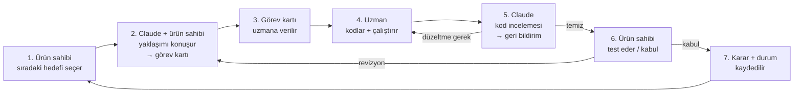

# Çalışma Planı — İş Birliği ve Uygulama Rehberi

**Sürüm:** 1.0
**Tarih:** 15 Eylül 2026
**Proje:** *Conductor* — İnsan Onaylı Çoklu-Asistan Orkestrasyonu
**Kardeş belge:** [`AI-Orkestrasyon-Mimari-Dokumani.md`](AI-Orkestrasyon-Mimari-Dokumani.md) (ne inşa edeceğiz)
**Bu belge:** Nasıl birlikte çalışacağız — roller, ritim, görev kırılımı, ilk oturum

---

## 0. Bu Belgenin Amacı

Mimari döküman **"ne"** sorusunu yanıtlıyor (protokol, tech stack, durum makinesi, fazlar). Bu belge **"nasıl birlikte çalışacağız"** sorusunu yanıtlıyor: üç taraf (sen, kodlama uzmanı, ben/Claude) arasında işin nasıl akacağını, kimin neyi yaptığını, görevlerin nasıl parçalanıp teslim edileceğini ve Faz 1'e hangi somut adımla başlayacağımızı tanımlar.

İki belge birlikte kullanılır: mimari = **referans/anayasa**, çalışma planı = **işletim kılavuzu**. Bir çelişki çıkarsa mimari belge esas alınır; karar değişirse **önce mimari belge güncellenir** (§6, Tek Doğruluk Kaynağı kuralı).

---

## 1. Ekip ve Roller

Üç taraf var. Kritik ayrım: **kodu uzman yazar, ben yazmam.** Ben mimar, danışman ve inceleyiciyim.

| Taraf | Rol | Sorumluluk |
|---|---|---|
| **Ürün Sahibi** | Karar Verici | Vizyon ve öncelik, görev sırası, gerçek dünya testi, nihai onay. Asistan hesaplarının/uygulamalarının sahibi (MCP kurulumu, izinler). |
| **Kodlama Uzmanı** | Uygulayıcı (Implementer) | Kodu yazar, çalıştırır, hata ayıklar, commit eder. Görev kartlarını hayata geçirir; mimariye sadık kalır; DoD'yi karşılar. |
| **Claude (ben)** | Mimar / Danışman / İnceleyici | Tasarım kararları, görev kartı üretimi, kod incelemesi, hata ayıklama stratejisi, fikir sparingi. Mimari belgeyi güncel ve tutarlı tutar. **Birincil kodlayıcı değilim.** |

### 1.1 Faaliyet Bazlı Sorumluluk (kim ne yapar)

> R = Yapan (Responsible) · A = Hesap veren/onaylayan (Accountable) · C = Danışılan (Consulted) · I = Bilgilendirilen (Informed)

| Faaliyet | Ürün Sahibi | Uzman | Claude |
|---|:---:|:---:|:---:|
| Öncelik / hangi görev sırada | **A** | C | C |
| Görev kartı yazma (spec) | C | C | **R** |
| Mimari karar | A | C | **R** |
| Kod yazma / çalıştırma | I | **R/A** | C |
| Kod incelemesi | I | C | **R** |
| Hata ayıklama (birlikte) | I | **R** | C |
| Kabul / gerçek dünya testi | **R/A** | C | I |
| MCP kurulumu, OS izinleri | **R/A** | C | C |
| Mimari belgeyi güncelleme | A | I | **R** |
| Karar kaydı (KARARLAR.md) | I | C | **R** |

**Okuma:** Yeni bir teknik seçim mi lazım? → Claude önerir, ürün sahibi onaylar, Uzman uygular. Kod mu yazılacak? → Uzman yazar, Claude inceler. Gerçek bir asistanla test mi? → Ürün sahibi yapar (hesaplar/izinler onda).

---

## 2. Çalışma Modeli — Üçlü İş Birliği Ritmi

Her görev tek yönlü basit bir döngüden geçer. Döngü kasıtlı olarak inşa ettiğimiz sistemin kendisini andırır (üret → onayla → ilet → işle):



**Döngünün altın kuralı:** Her tur **tek, küçük, tamamlanabilir bir görev** üzerinde döner (§4'teki görev kartları). Büyük parça gelirse önce bölünür. Bir görev "bitti" demek için DoD'sinin yeşil olması + Claude incelemesinden geçmesi + ürün sahibinin kabul etmesi gerekir.

### 2.1 Kodlama Uzmanı İnsan mı, AI mı?

Plan her iki durumda da çalışır; tek fark teslim mekaniğinde:

- **AI kodlama ajanı ise** (Cursor, Copilot agent, Codex vb.): Görev kartını doğrudan ajana yapıştırırsın; ajan kodu workspace'e yazar. Claude incelemesi için değişen dosyaları/diff'i bana getirirsin.
- **İnsan geliştirici ise:** Görev kartı bir "ticket" gibi çalışır; PR/commit üzerinden ilerler; incelemeyi diff üzerinden yaparım.

Her iki halde de **görev kartı ortak dildir** (§5).

---

## 3. Aramızdaki İletişim Protokolü (Sürekliliğin Anahtarı)

> **Kritik gerçek:** Ben oturumlar arasında hafıza taşımam. Her yeni Claude oturumu **sıfırdan** başlar. Süreklilik, kodda ve iki küçük dosyada yaşamak zorunda.

Bu yüzden kendi iş birliğimiz için sistemimizin minyatür bir versiyonunu "dogfood" ediyoruz — projede iki kayıt dosyası tutuyoruz:

```
_isbirligi/
├── DURUM.md        # anlık durum: hangi görev nerede (Bekliyor/Yapılıyor/İncelemede/Bitti)
├── KARARLAR.md     # append-only karar kaydı: tarih, karar, gerekçe, kim
└── gorevler/       # verilmiş görev kartları (G1.md, G2.md, ...)
```

- **DURUM.md** — tek bakışta nerede olduğumuzu gösterir. Her görev turunda güncellenir.
- **KARARLAR.md** — "neden böyle yaptık" sorusunun cevabı. Yalnızca eklenir, silinmez. Yeni bir oturum açtığında bana ilk bunu okuturursun; kaldığımız yerden devam ederiz.
- **gorevler/** — verilen her görev kartının kopyası.

### 3.1 Bana Bir Görev/Soru Getirirken Ver

İyi bağlam = iyi cevap. İdeal paket:
1. **Ne yapmak istiyorsun** (tek cümle hedef).
2. **İlgili mimari bölüm** (ör. "§5.4 durum makinesi").
3. **Mevcut durum** — ilgili kod/dosya, hata mesajı (tam metin), ne denendi.
4. **Karar mı, inceleme mi, hata ayıklama mı** istiyorsun (ne tür yardım).

### 3.2 Ne Zaman Bana Danışılır, Ne Zaman Doğrudan Karar Verilir

| Durum | Aksiyon |
|---|---|
| Mimariyi etkileyen seçim (kütüphane, şema, protokol değişikliği) | **Bana danış** → KARARLAR.md'ye yaz |
| Görev kartında zaten tanımlı, mekanik uygulama | Uzman **doğrudan** yapar |
| DoD'yi karşılamayan/belirsiz nokta | Bana danış (kartı netleştiririm) |
| Stil/isimlendirme, yerel refactor | Uzman karar verir; inceleme yakalar |
| Mimariden sapma gerekiyor | **Dur** → önce mimari belgeyi güncelle (§6) |

---

## 4. Faz 1 İş Kırılımı (Backlog)

Mimari §7'deki Faz 1 hedefini — **ChatGPT → Claude, manuel onaylı, dosya tabanlı tek yön** — sıralı, küçük, atanabilir görevlere böldüm. Sıra bağımlılığa göredir. Teknoloji: mimari §5.2 önerisiyle **Python prototipi** (watchdog + FastAPI + SQLite); ürünleşmede Tauri'ye taşınır.

| # | Görev | Bağımlılık | Çıktı (DoD özeti) | Mimari § |
|---|---|:---:|---|:---:|
| **G1** | Proje iskeleti & workspace | — | Klasör yapısı + venv + bağımlılıklar + README ayakta | §5.7 |
| **G2** | SQLite depo & şema | G1 | `envelopes` + `history` + **dondurulmuş içerik snapshot'ı (K-003)**, temel DAO, migration | §5.3 |
| **G3** | Durum makinesi modülü | G2 | İzinli geçişler + her geçiş audit kaydı | §5.4 |
| **G4** | Dosya izleyici (watcher) | G2,G3 | outbox izle → debounce → checksum → zarf → PENDING_APPROVAL | §4.1, §7.5 |
| **G5** | Atomik teslim | G3 | benzersiz `<msg_id>.md` (K-004) + niyet-günlüğü, snapshot'tan yaz, checksum doğrula | §4.1, §7.7 |
| **G6** | FastAPI backend | G3,G4,G5 | queue/detay/approve/reject/edit-approve uçları | §7.6 |
| **G7** | Onay paneli UI | G6 | kuyruk + önizleme + düzenle + aksiyonlar + durum rozeti (**İletildi≠İşlendi, K-005**) | §7.6 |
| **G8** | Claude MCP & uçtan uca | G5 | Claude inbox'ı MCP ile okur; trigger=human akışı çalışır | §7.2, §7.7 |
| **G9** | Dayanıklılık & kabul | tümü | §7.9 checklist tamamı yeşil; restart'ta kuyruk korunur | §7.9 |

**Öneri (mimari §7.2):** ChatGPT tarafında Faz 1'e **"insan-taşıyıcı" (b) seçeneğiyle** başla — ChatGPT çıktısını sen bilinçli olarak `chatgpt/outbox/output.md`'ye kaydedersin. Bu hâlâ dosya tabanlıdır ve MCP kurulum sürtünmesini Faz 1'den çıkarır. Çekirdek çalışınca ChatGPT/Codex MCP'sine (a) yükseltiriz.

### 4.1 Görev Detayları

Aşağıdaki ilk üç görev **tam kart** halinde, hemen başlanabilir (§5 şablonu). Kalanlar tek satır DoD ile; sıraları geldiğinde tam karta açarım.

---

#### 🟢 G1 — Proje İskeleti & Workspace  *(hazır)*

- **Amaç:** Boş bir çalışan iskelet: workspace klasörleri + Python ortamı + bağımlılıklar.
- **Girdi:** Mimari §5.7 klasör şeması.
- **Adımlar:**
  - `ai-orchestrator/` kökü ve alt klasörleri oluştur (§5.7): `agents/{chatgpt,claude}/{inbox,outbox}`, `queue/`, `archive/{delivered,rejected}`, `.system/tmp/`.
  - Python `venv` + `requirements.txt`: `watchdog`, `fastapi`, `uvicorn`, (SQLite stdlib — ek gerekmez).
  - `README.md`: nasıl çalıştırılır (tek komut hedefi).
- **Çıktı / DoD:**
  - [ ] Klasör ağacı §5.7 ile birebir.
  - [ ] `pip install -r requirements.txt` temiz geçer.
  - [ ] `python -m app` (boş) hatasız açılır.
- **İlgili §:** 5.7 · **Test:** `tree` çıktısı şemaya eşit.

---

#### 🟢 G2 — SQLite Depo & Şema  *(hazır)*

> ⤷ **Güncel tam kart:** `_isbirligi/gorevler/G2.md` (yerel kayıt) — K-003 (değişmez sürümler + onaylanan sürüm kimliği), K-004 (teslim yolu/hash), durum+audit **tek transaction** (compare-and-set) dahil. Aşağıdaki özet tarihseldir; **uygulamada G2.md esas alınır.**

- **Amaç:** Tek doğruluk kaynağı: zarflar, durumlar, audit geçmişi.
- **Girdi:** Mimari §5.3 (zarf JSON şeması), §5.4 (durum listesi).
- **Adımlar:**
  - `envelopes` tablosu: `id, schema_version, created_at, source_agent, target_agent, type, title, payload_ref, sha256, bytes, mode, trigger, state, approved_by, edited, note`.
  - `history` tablosu (audit): `id, envelope_id, state, at, actor, detail` — **yalnızca ekleme**.
  - İnce DAO: `insert_envelope`, `get`, `list_by_state`, `set_state (history'e de yazar)`.
- **Çıktı / DoD:**
  - [ ] Şema migration'la kuruluyor; ikinci çalıştırmada bozulmuyor.
  - [ ] `set_state` her çağrıda `history`'e satır ekliyor.
  - [ ] Basit birim test: insert → get → set_state → history 1 satır.
- **İlgili §:** 5.3, 5.4 · **Test:** birim test yeşil.

---

#### 🟢 G3 — Durum Makinesi Modülü  *(hazır)*

> **Güncel tam kart:** `_isbirligi/gorevler/G3.md` (yerel kayıt). Faz 1 geçişleri, kapalı Faz 2 yolları, G2 transaction/sürüm/hash entegrasyonu ve test planı burada tanımlıdır. Aşağıdaki tarihsel özet yerine uygulamada tam kart esas alınır.

- **Amaç:** §5.4 diyagramını koda dökmek; geçersiz geçişleri reddetmek.
- **Girdi:** Mimari §5.4 (durumlar + geçişler).
- **Adımlar:**
  - İzinli geçiş haritası (ör. `PENDING_APPROVAL → {APPROVED, REJECTED, EXPIRED}`).
  - `transition(envelope_id, event)` → doğrula, uygula, `history`'e yaz (G2'yi kullanır).
  - Geçersiz geçişte açık hata (ve log).
- **Çıktı / DoD:**
  - [ ] Tüm §5.4 geçişleri tanımlı.
  - [ ] Geçersiz geçiş `InvalidTransition` fırlatıyor.
  - [ ] Her başarılı geçiş audit'te.
- **İlgili §:** 5.4 · **Test:** izinli + izinsiz geçiş birim testleri.

---

#### G4 — Dosya İzleyici
outbox'ta `.md` görülünce: debounce (yarım yazımı önle) → SHA-256 → zarf üret → `DETECTED→CAPTURED→PENDING_APPROVAL` → DB'ye yaz + panele bildir. **DoD:** boş/yarım dosya yanlış tetikleme yapmıyor; checksum doğru. (§4.1, §7.5)

#### G5 — Atomik Teslim
`deliver_atomic`: onaylı **snapshot içeriğinden** (K-003) `.system/tmp/`'ye yaz → `os.link` ile tamamlanmış geçici dosyayı `claude/inbox/<msg_id>__<baslik>.md` yolunda atomik yayımla (**benzersiz ad**, üzerine yazma yok — K-004) → niyet-günlüğü: önce DB `DELIVERING`, sonra `DELIVERED`; açılışta uzlaştır → hedef checksum = onaylanan sürüm. **DoD:** yarı yazılmış dosya asla inbox'ta görünmez; **ardışık teslimde kayıp yok**; checksum eşleşir. (§4.1, §7.7)

#### G6 — FastAPI Backend
Uçlar: `GET /queue`, `GET /message/{id}`, `POST /message/{id}/approve`, `.../reject`, `.../edit-approve` (düzenlenmiş içerik + diff audit'e). Approve → G3 geçişi + G5 teslim. Reject → `archive/rejected/`. **DoD:** her uç doğru durum geçişini tetikliyor; reddedilen inbox'a **yazılmıyor**. (§7.6)

#### G7 — Onay Paneli UI
Ekranlar (§7.6): Kuyruk (kaynak/tür/başlık/zaman) · Detay (markdown önizleme + düzenlenebilir alan) · Aksiyonlar (Onayla / Reddet / Düzenle-Onayla) · Durum rozetleri (Bekliyor·Onaylandı·Reddedildi·İletildi). Kuyruk 3 sn içinde güncellenir (polling yeter). **DoD:** §7.1 kabul kriteri 1–3 gözle doğrulanır. (§7.6)

#### G8 — Claude MCP & Uçtan Uca
`claude_desktop_config.json`'a Filesystem MCP (§7.2), köke yönlendir. Uçtan uca: outbox'a dosya at → panelde beliriyor → düzenle+onayla → inbox'ta atomik beliriyor → Claude'a "inbox'ındaki **teslim edilen dosyayı** oku ve işle" (trigger=human). Dosya yazımı **yalnızca DELIVERED**; işleme kanıtı olmadan CONSUMED sayılmaz (K-005). **DoD:** Claude inbox'ı okuyup işliyor. (§7.2, §7.7)

#### G9 — Dayanıklılık & Kabul
Mimari §7.9 checklist'inin tamamı: debounce/atomik, checksum, reddedilen arşive, düzenleme diff'i audit'te, **restart sonrası `PENDING_APPROVAL` kuyruğu duruyor**, MCP izin/yol doğru. **DoD:** 6 madde de yeşil = Faz 1 tamam. (§7.9)

---

## 5. Görev Kartı Şablonu

Her yeni görev bu şablonla verilir (yukarıdaki G1–G3 örnek). Ortak dilimiz budur:

```markdown
### [Görev ID] — [Kısa başlık]
- **Amaç:** (tek cümle: bu görev neyi çözer)
- **Girdi:** (ilgili mimari §, mevcut kod/dosya, bağımlı görevler)
- **Adımlar:** (uygulanacak somut adımlar)
- **Çıktı / DoD:** (kutucuklu kabul kriterleri — hepsi ✓ olmadan "bitti" denmez)
- **İlgili §:** (mimari referans) · **Test:** (nasıl doğrulanır)
```

**Kart kuralları:** Bir kart tek oturumda bitebilecek kadar küçük olmalı. "DoD" ölçülebilir olmalı (his değil, kanıt). Kart mimariden sapıyorsa → önce mimari güncellenir.

---

## 6. Kalite Kapıları & Tek Doğruluk Kaynağı

**İki kapı, her görevde:**
1. **Kod incelemesi (Claude):** doğruluk (durum geçişleri, atomik yazma, checksum), sağlamlık (hata yolları, restart), sadelik (mimariye uyum, gereksiz karmaşa yok), güvenlik (yol sandbox'ı §6, pano hijyeni). Çıktı: "temiz" ya da madde madde düzeltme.
2. **Kabul (ürün sahibi):** DoD kutuları + gerçek asistanla davranış.

**Tek Doğruluk Kaynağı kuralı:** Uygulama sırasında mimariden sapma gerekirse (daha iyi bir yol bulundu, bir varsayım yanlış çıktı):
- Kodu değiştirmeden **önce** dur.
- Değişikliği KARARLAR.md'ye yaz (ne, neden).
- Etkilenen mimari bölümü **güncelle** (bunu ben yaparım).
- Sonra uzman uygular.

Böylece mimari belge hiçbir zaman koddan geri kalmaz; yeni bir oturum güncel gerçeği okur.

---

## 7. İlerleme Takibi

`_isbirligi/DURUM.md` basit bir kanban tutar:

```markdown
# Durum — Faz 1

## Bitti ✅
- (henüz yok)

## İncelemede 🔍
- (henüz yok)

## Yapılıyor 🚧
- (henüz yok)

## Sırada 📋
- G1 Proje iskeleti  → G2 → G3 → G4 → G5 → G6 → G7 → G8 → G9

Son güncelleme: —
```

**Oturum başlangıç ritüeli (her yeni Claude oturumunda):** Bana `KARARLAR.md` + `DURUM.md`'yi okut → nerede kaldığımızı çıkarırım → sıradaki karta geçeriz.

---

## 8. Kilometre Taşları & Kaba Efor

Süre uzmanın hızına bağlı; bu yüzden saat yerine **oturum** (odaklı çalışma bloğu) veriyorum. Dürüst, şişirilmemiş kaba tahmin:

| Kilometre taşı | Görevler | Kaba efor |
|---|---|---|
| **M1 — Çekirdek ayakta** | G1–G3 | 1–2 oturum |
| **M2 — Uçtan uca boru hattı (UI'siz)** | G4–G5 | 1–2 oturum |
| **M3 — Onay paneli çalışıyor** | G6–G7 | 2–3 oturum |
| **M4 — Faz 1 tamam (gerçek Claude ile)** | G8–G9 | 1–2 oturum |

Toplam Faz 1: kabaca **5–9 oturum**. Sonraki fazlar mimari §8 yol haritasında.

---

## 9. Yürütme Riskleri (İş Birliğine Özel)

Mimari §9 ürün risklerini kapsar; burada **çalışma sürecine** özel olanlar:

| Risk | Azaltım |
|---|---|
| Claude oturumlar arası hafızasız | KARARLAR.md + DURUM.md; oturum başı ritüel (§7) |
| Kapsam kayması (Faz 1 şişer) | Katı DoD; kapsam dışı listesi (mimari §7.1); "önce Faz 1 yeşil" |
| Mimari-kod uyumsuzluğu | Tek Doğruluk Kaynağı kuralı (§6) |
| ChatGPT MCP kurulum sürtünmesi | Faz 1'e insan-taşıyıcı (b) ile başla (§4) |
| Uzman ↔ Claude kopukluğu | Görev kartı ortak dil (§5); inceleme diff üzerinden |
| Aşırı mühendislik | Python prototip önce; Tauri sonra (mimari §5.2) |

---

## 10. İlk Oturum — Somut Başlangıç

Hazırsan sıradaki adım şu (uzmana verilecek ilk paket):

1. **`_isbirligi/` kur** — `DURUM.md` (§7 şablonu) + boş `KARARLAR.md` + `gorevler/`.
2. **G1'i uzmana ver** (§4.1 tam kart) — proje iskeleti & workspace.
3. G1 bitince **bana getir** — inceleme → DURUM.md güncelle → **G2**.
4. Sırayla G2 → G3 (M1 kilometre taşı).

**Kaydedilmiş başlangıç kararları:**
- **K-001:** Kodlama uzmanı göreve göre AI ajanı veya insan geliştirici; görev kartları her ikisine de devredilebilir.
- **K-002:** ChatGPT tarafı Faz 1'de **insan-taşıyıcı (b)**; MCP/Codex yükseltmesi Faz 2'ye bırakıldı.
- İş birliği dosyaları oluşturuldu; sıradaki iş hazır **G1** kartıdır. Bu iki karar için yeniden onay gerekmiyor.

**Kodlama öncesi inceleme ve uzmanla devir planı:** `_isbirligi/Mimari-Inceleme-ve-Devir.md` (yerel kayıt). Buradaki teknik öneriler kabul edilmiş mimari kararların yerine geçmez.

---

*Bu belge canlıdır; her görev turunda DURUM.md güncellenir, her mimari sapma KARARLAR.md'ye ve mimari belgeye yansır. Mimari referans: [`AI-Orkestrasyon-Mimari-Dokumani.md`](AI-Orkestrasyon-Mimari-Dokumani.md).*
