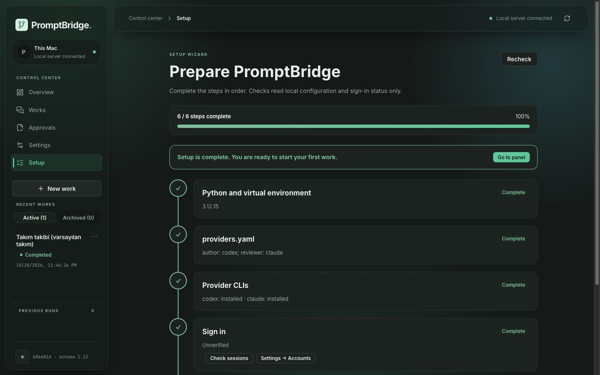
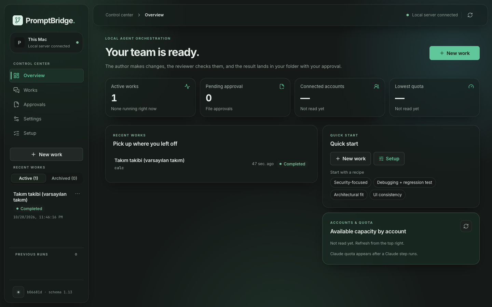
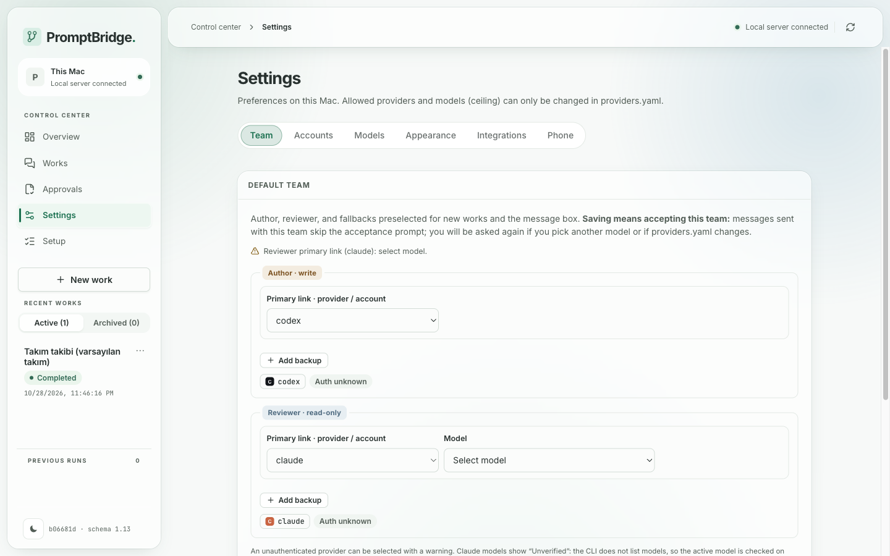

**English** · [Türkçe](README.tr.md)

[](https://github.com/avcibunyamin/PromptBridge/actions/workflows/ci.yml)

# PromptBridge

**PromptBridge — a supervised AI coding team on your own machine.**

- Run **Claude Code**, **Codex**, **Antigravity (Gemini)** and **Ollama** as an **author → independent read-only reviewer** team.
- For developers who already pay for AI coding subscriptions and want a second model to check the first — **no API keys needed**.
- A different model reviews every change, your tests run before review as evidence (macOS sandbox), and every step is logged in an append-only local audit trail.


<sub>Demo data from a test fixture with fake providers.</sub>

> **Naming:** the product is **PromptBridge**. **Conductor** is only the name of its internal server component (the local watcher + API + web panel process in `ai-orchestrator/`).

---

## Requirements

- **OS:** macOS (primary). Linux: server and panel only — see [Platform support](#platform-support).
- **Python 3.12+** and **Node.js 22.6+** (only to rebuild the panel or run the UI tests) (on macOS: `brew install python@3.12 node`).
- **At least one provider CLI:** Claude Code (`claude`), Antigravity (`agy`), Codex (`codex`) or Ollama (`ollama`).
- Optional: `gh` (GitHub clone / draft PR), `tailscale` (phone access), Xcode Command Line Tools (Mac app).

---

## Quick start

All commands after step 1 run inside `ai-orchestrator/`.

1. **Clone:**
   ```sh
   git clone https://github.com/avcibunyamin/PromptBridge && cd PromptBridge
   cd ai-orchestrator
   ```
2. **Create a virtual environment and install requirements:**
   ```sh
   python3 -m venv .venv
   .venv/bin/python -m pip install -r requirements.txt
   ```
   `python3` must be 3.12 or newer (`python3 --version`); use `python3.12` explicitly if your default is older.
3. **Create `.system/providers.yaml`** — run the `cp` command that matches the CLIs you have:
   ```sh
   mkdir -p .system
   cp providers.example.yaml .system/providers.yaml         # default (codex + claude)
   # cp providers.claude-only.yaml .system/providers.yaml   # claude only
   # cp providers.codex-only.yaml .system/providers.yaml    # codex only
   # cp providers.agy-only.yaml .system/providers.yaml      # agy only (two accounts)
   # cp providers.ollama-local.yaml .system/providers.yaml  # ollama (local)
   ```
4. **Panel:** a built panel ships in `app/static/`; rebuild it only if you change the UI: `cd ui && npm install && npm run build && cd ..`
5. **Sign in providers** (only the ones you use):
   - **Claude Code:** run `claude` and use `/login`.
   - **Codex:** `CODEX_HOME="$PWD/.system/codex-home" codex login`
   - **Antigravity:** after opening the panel in Step 7, add the account under **Settings → Accounts** and run the command shown there.
   - **Ollama:** `ollama serve` runs in a separate terminal (or keep the Ollama app open).
6. **Check the setup, then start the server:**
   ```sh
   .venv/bin/python -m app doctor     # python, providers.yaml, CLIs, panel — no provider calls
   .venv/bin/python -m app serve
   ```
   A `server not running` `WARN` from `doctor` before starting the server is normal. If the port is busy, use `.venv/bin/python -m app serve --port <PORT>`; see `.venv/bin/python -m app --help` for all commands.
7. **Open <http://127.0.0.1:8765/ui/>.** On a fresh install the **setup wizard** (`#/setup`, also in the sidebar as **Setup**) opens and checks each step for you; before your first work, check session status under **Settings → Accounts**.
8. **Optional — auto-start on macOS:** stop the foreground `serve` with `Ctrl-C` first (same port), then run `deploy/launchd.sh install`. Stop it with `deploy/launchd.sh uninstall`; a plain `kill` is restarted by launchd.

Optional native Mac app: `cd ../apps/mac && make install` (see [apps/mac/README.md](apps/mac/README.md)).

---

## Setup wizard

The panel checks your installation with the same checks as `python -m app doctor` (read-only, no provider calls) and shows each step with its status and a command to copy.



| Overview | Settings |
|---|---|
|  |  |

<sub>Screens from a test fixture with fake providers. Light and dark themes follow your system or **Settings → Appearance**.</sub>

---

## Your first work

1. In **Overview**, click **New work**.
2. Pick your project folder (if it is a git repository, check **Work in a separate copy**).
3. Write the task and confirm the team (**Send**).
4. Author, reviewer, and fix steps stream in **Works**; when finished in a separate copy, click **Bring to main folder**.

---

## How it works

1. You pick a project folder and a team (author + reviewer) and write the task.
2. The **author** model makes the change with a write-enabled profile.
3. Your approved **tests and lint run first** (in a no-network sandbox on macOS); the results go to the reviewer as evidence.
4. A **different, independent reviewer** model inspects the diff with **read-only** tools and reports findings.
5. The author addresses the findings; you accept the result when you are satisfied.

For first runs, an **isolated copy** (separate git worktree) is recommended: your main folder is not touched until you click **Bring to main folder**.

---

## What runs without asking you

- **You approve** the team and the provider tool permissions.
- The **author → reviewer handover is automatic** by default (`require_handover_approval: false`).
- If **loop** is enabled, rounds continue automatically.
- When a provider's quota runs out, **only the next provider in the chain** takes over — nothing outside the chain you configured.

---

## Data flow & security

- The server listens **only on 127.0.0.1** — but your **code and prompts go to the cloud providers you choose**. Only **Ollama** stays local.
- **Phone access** goes through **your own Tailscale tailnet**. New devices can only view and approve; stop/dispatch must be enabled per device on the Mac.
- **Reviewers are read-only.**
- **Prompts never pass through a shell.**
- Details and vulnerability reporting: [SECURITY.md](SECURITY.md).

---

## Platform support

| Feature | macOS | Linux |
| --- | :---: | :---: |
| Server + web panel | ✓ | ✓ |
| launchd auto-start | ✓ | — (macOS only) |
| Pre-review tests in a no-network sandbox | ✓ | — (not available on Linux) |
| Preview sandbox (optional) | ✓ | — (macOS only) |
| Antigravity account isolation via keychain | ✓ | — |
| Mac app | ✓ | — |
| Phone via Tailscale | ✓ | ✓ |

---

## Your responsibility

Using several subscription accounts and automatic fallback between them may be limited by each provider's terms of service. Check the terms of every provider you use.

---

## Documentation

- [User Guide (English)](docs/USER-GUIDE.md) — installation, provider setup, workflows, phone pairing, security model, troubleshooting, FAQ.
- [Kullanım Kılavuzu (Türkçe)](docs/KULLANIM-KILAVUZU.md) — Turkish user guide.
- [Operator guide (Turkish)](OPERATOR-REHBERI.md) — daily operations, backup/restore, troubleshooting.
- [Architecture document (Turkish)](AI-Orkestrasyon-Mimari-Dokumani.md) — state machines, security boundaries, design decisions.
- [CONTRIBUTING.md](CONTRIBUTING.md) — running tests, branches, author → reviewer flow.
- [SECURITY.md](SECURITY.md) — vulnerability reporting and threat model.
- [CHANGELOG.md](CHANGELOG.md) — release notes.
- [Server README](ai-orchestrator/README.md) · [Mac app README](apps/mac/README.md)

---

## License

[MIT](LICENSE) — `Copyright (c) 2026 PromptBridge contributors`.
