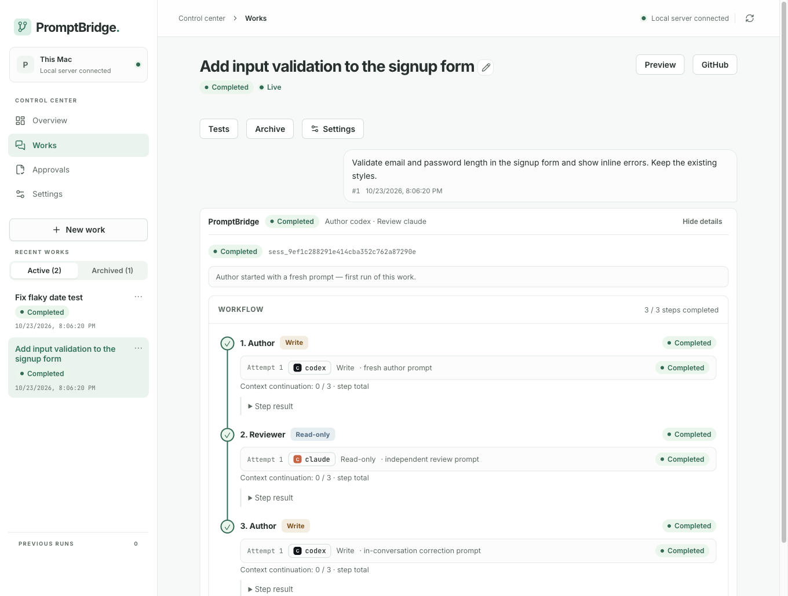

[English](README.md) · **Türkçe**

# PromptBridge (Conductor)


<sub>Sahte sağlayıcılı test fikstüründen örnek veri.</sub>

**PromptBridge (Conductor)**, yapay zeka kodlama CLI araçlarını (**Claude Code**, **Antigravity `agy` / Gemini**, **Codex**, **Ollama**) **yazar → inceleyici** zincirinde, **API anahtarı gerekmeden kendi mevcut aboneliklerinle** ve **yerel bir sunucuyla** (`127.0.0.1`; kod ve istemler seçtiğiniz bulut sağlayıcılara gider, yalnız Ollama yereldir) çalıştıran insan onaylı bir çoklu-AI orkestrasyon sistemidir.

Bir model kodu yazar (yazma yetkili profil), bağımsız bir model ise salt okunur araçlarla kodu inceler ve bulgularını raporlar. Her adım, onay ve durum geçişi yerel SQLite veritabanında denetlenebilir biçimde kayıt altına alınır.

---

## Ekran ve Sistem Özellikleri

- **Çalışmalar (Works):** Proje klasörlerinde kalıcı çalışma oturumları başlatın. İsteğe bağlı **ayrı kopyada çalışma (git worktree)** ile ana çalışma klasörünüze dokunmadan paralel görevler yürütün ve bittiğinde tek tıkla ana klasöre birleştirin. Sonuca göre **yazar ↔ inceleyici döngüsü**, devam kapısı ve çökme sonrası süreç kurtarma (`RECOVERY_REQUIRED`) desteklenir.
- **Onaylar (Approvals):** İki yönlü dosya aktarım kuyruğunda yakalanan çıktıları ve sağlayıcıların istediği araç izinlerini panelden önizleyin, düzenleyin, onaylayın veya reddedin.
- **Kota / Bağlam Halkası ve Yedek Zinciri:** Mesaj kutusunda model, hesap ve düşünme eforunu (`provider[@<hesap>][/model][~effort]`) seçin; model/efor seçicinin yanındaki **bağlam/kota halkası** üzerinden bağlam kullanım oranını (doluluk) ve kalan kotayı (renk) izleyin. Mesaj kutusunun başında `/` kısayollarıyla (`/model`, `/efor`, `/kota`, `/takim`, `/onizleme`, `/testler`, `/github`, `/yeni`) seçicileri ve panelleri hızla açın. Bir sağlayıcıda kota dolduğunda zincirdeki yedek sağlayıcıya otomatik devredilir veya sınırlı kota bekleme planı devreye girer.
- **Testler ve Lint / Tip Denetimi:** İnceleyici adımdan önce onayladığınız test (`unittest`, `pytest`, `npm test`) ve lint/tip denetimi (`ruff`, `flake8`, `mypy`, `tsc`, `npm run lint`) komutları ağsız korumalı alanda otomatik koşar; sonuçlar doğrudan inceleyiciye kanıt olarak sunulur.
- **Önizleme (Preview):** Çalışma klasöründeki web/uygulama sunucusunu onaylı komutla panel içinden başlatın, durdurun ve görüntüleyin (isteğe bağlı macOS `sandbox-exec` korumalı alan desteğiyle).
- **GitHub Entegrasyonu:** Yerel `gh` oturumunuzu kullanarak panelden depo klonlayın, gizli dosya ve iş akışı (workflow) uyarılarıyla güvenli commit oluşturun, yeni dala push yapın ve **taslak PR (Draft PR)** açın.
- **Telefon Erişimi (Mobil Geçit):** Tailscale üzerinden şifreli bağlantıyla telefonunuzu 6 haneli tek kullanımlık kodla eşleştirin. Çalışmaları canlı izleyin, onay verin; izin verdiğiniz cihazlardan yürütmeyi durdurun veya yeni görev gönderin.
- **Mac Uygulaması ve `launchd` Servisi:** Web panelinin yanı sıra yerel SwiftUI Mac uygulaması (`apps/mac`) ve makine açılışında otomatik başlayan `launchd` arka plan servisi ile kesintisiz çalışır.

---

## Gereksinimler

- **İşletim Sistemi:** macOS (launchd, Keychain, `sandbox-exec` ve SwiftUI Mac uygulaması için önerilir) veya Linux (temel sunucu ve web paneli)
- **Python:** Python 3.12+
- **Node.js:** Node.js 18+ ve `npm` (React/TypeScript panelini derlemek için)
- **Sağlayıcı CLI Araçları (en az biri):**
  - **Claude Code** (`claude` CLI — kendi Claude aboneliğinizle giriş yapılmış)
  - **Antigravity CLI** (`agy` — Google hesabınızla Gemini / Claude modelleri)
  - **Codex CLI** (`codex` — ChatGPT aboneliğinizle giriş yapılmış)
  - **Ollama** (`ollama` — `127.0.0.1:11434` üzerinde yerel araç destekli modeller)
- **İsteğe Bağlı Araçlar:**
  - `gh` (GitHub CLI — GitHub klonlama ve taslak PR akışı için)
  - `tailscale` (Telefon eşleştirme ve mobil erişim için)
  - Xcode Command Line Tools (`swiftc` — `apps/mac` yerel Mac uygulamasını derlemek için)

---

## Hızlı Kurulum

```sh
# 1. Python sanal ortamını kurun ve bağımlılıkları yükleyin
cd ai-orchestrator
python3.12 -m venv .venv
.venv/bin/python -m pip install -r requirements.txt

# 2. Sağlayıcı politika dosyasını oluşturun
mkdir -p .system
cp providers.example.yaml .system/providers.yaml
# Varsayılan zincir codex ve claude ister; yalnız birini kurduysanız .system/providers.yaml içindeki roles listelerinden kurulu olmayanı silin.

# 3. Web panelini derleyin
cd ui && npm install && npm run build && cd ..

# 4. Kurulumu denetleyin, sonra sunucuyu başlatın (veya launchd servisi olarak kurun)
.venv/bin/python -m app doctor   # python, providers.yaml, CLI'lar, panel — sağlayıcı çağrısı yok
.venv/bin/python -m app serve
# Otomatik başlatma için (macOS): deploy/launchd.sh install

# 5. Sağlık kontrolü
curl -s http://127.0.0.1:8765/health
```

Tarayıcıdan yönetim panelini açın: **<http://127.0.0.1:8765/ui/>**

İsteğe bağlı olarak yerel Mac uygulamasını (`/Applications/PromptBridge.app`) kurmak için:

```sh
cd ../apps/mac  # ai-orchestrator içindeyseniz
make install
```

---

## Belgeler

- **[Kullanım Kılavuzu (Türkçe)](docs/KULLANIM-KILAVUZU.md):** Kurulum, sağlayıcı hesap bağlama (`agy`, Codex, Claude, Ollama), `providers.yaml`, ilk çalışma, mesaj kutusu, testler, önizleme, GitHub, telefon eşleştirme, Mac uygulaması, güvenlik modeli ve SSS.
- **[User Guide (English)](docs/USER-GUIDE.md):** Full English user guide covering installation, provider setup, workflows, mobile pairing, security model, troubleshooting, and FAQ.
- **[Operatör Rehberi](OPERATOR-REHBERI.md):** Günlük işletim, canlıya geçiş prosedürü, yedekleme/geri dönüş ve ayrıntılı sorun giderme.
- **[Mimari Doküman](AI-Orkestrasyon-Mimari-Dokumani.md):** Sistem mimarisi, durum makineleri, güvenlik sınırları ve faz kararları.
- **[Katkıda Bulunma (CONTRIBUTING.md)](CONTRIBUTING.md):** Testleri çalıştırma, dal ve yazar → inceleyici inceleme akışı.
- **[Güvenlik Politikası (SECURITY.md)](SECURITY.md):** Güvenlik açığı bildirimi ve tehdit modeli özeti.
- **[Sürüm Notları (CHANGELOG.md)](CHANGELOG.md):** Sürüm notları ve değişiklik geçmişi.
- **[Sunucu README](ai-orchestrator/README.md)** · **[Mac Uygulaması README](apps/mac/README.md)**

---

## Lisans

Bu proje [MIT Lisansı](LICENSE) altında açık kaynak olarak lisanslanmıştır. (`Copyright (c) 2026 PromptBridge contributors`)
